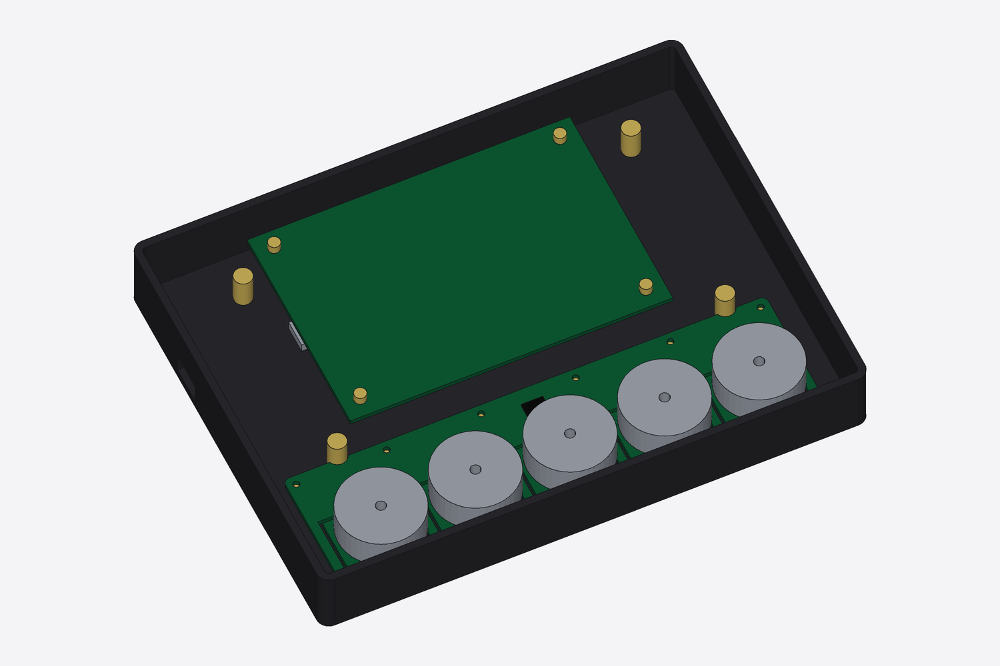

# clickdeck

> [!CAUTION]
> **This is AI-generated and completely untested.** Nothing here has been
> built, assembled, flashed or measured: not the CAD, not the PCBs, not the
> parts list, not the costs. It was produced by an AI assistant
> (Claude) during planning conversations, and it will contain mistakes.
> Treat every dimension, part number, price and claim as a guess until it's
> verified on real hardware. Don't order anything based on this without
> checking it yourself.

A custom Stream Deck–style USB controller: per-key images, real clicky micro
switches, and motor-driven knobs that switch between clicky and smooth in
software.

## Why not just buy a Stream Deck + XL?

What this adds:
- **Programmable knobs.** Each knob switches per function between clicky,
  smooth, a set number of clicks, or hard end stops, and can push back
  (a tick at a preset, a nudge for attention). They also press to click.
  Stream Deck dials have one fixed feel.
- **Clicky keys.** Micro switches instead of soft rubber pads.
- **Open and Linux-first.** Open hardware, open USB protocol, your own
  firmware. Works with [OpenDeck](https://github.com/nekename/OpenDeck),
  which runs Stream Deck plugins, so you aren't starting from zero.

Like the + XL, it has a touch band under the knob displays for taps and
swipes.

What the + XL does better: it's polished and ready today, has 36 keys, its
plugins all just work (some won't through OpenDeck), and it costs about the
same or less (see below). Build this for the knobs and the switch feel; if
those don't matter, buy the + XL.

## Cost (rough estimates)

| | ~Cost |
|---|---|
| **Build one, with your own 3D printer** | **$300–450** |
| Build one, case ordered from JLC3DP | $330–525 |
| Per unit, 5 people ordering together | $195–370 |
| Stream Deck + XL, for comparison | ~$350 |

Covers parts, PCBs (JLC's 5-board minimum and 2-board assembly minimum
included), prints, ready-made internal cables and shipping, in two orders:
JLC (all PCBs in one panel, plus prints) and AliExpress/Waveshare. No
soldering or crimping: JLC fits every part, and every cable inside plugs in.
The five motor drivers (~$26) are the biggest cost after the display.
Breakdown: [docs/cost.md](docs/cost.md); every part: [docs/bom.md](docs/bom.md).

## Design

| Exploded | Key profile (cap, tab, switch) |
|---|---|
|  |  |

Prototype (2 keys + 1 knob, laser-cut acrylic):

Inside, with the panel removed: Waveshare's board at the back, the knob
board across the front, the USB board (hub) in the back-left corner with the
USB-C port in the back wall:

Cabling from above (display and top plate removed): one USB-C cable in, a
hub on the USB board, a short USB-C cable to the display board and a
latching JST-GH cable to the knob board. Every cable is bought and plugged
in ([docs/wiring.md](docs/wiring.md)):

Knob board (one PCB, five knobs). Each knob sits on a hinged tongue that
presses a switch underneath; motors lifted to show the tongues:

- [docs/assembly.md](docs/assembly.md): assembly and service guide, with pictures and an animation (generated from the CAD)
- [docs/plan.md](docs/plan.md): goals, architecture, and the staged build plan
- [docs/parts.md](docs/parts.md): prototype parts list with links
- [docs/cost.md](docs/cost.md): cost breakdown
- [docs/bom.md](docs/bom.md): full-build bill of materials (generated from the CAD)
- [docs/lessons.md](docs/lessons.md): lessons from related projects, so we don't relearn them
- [docs/wiring.md](docs/wiring.md): power path, cables and connectors, strain relief, key matrix, pin budget
- [docs/knob-module.md](docs/knob-module.md): Rev 0 knob module netlist, parts and design notes
- [docs/protocol.md](docs/protocol.md): USB protocol draft (two USB devices behind a hub)
- [hardware/](hardware/): KiCad boards generated from the CAD
- [docs/open-questions.md](docs/open-questions.md): what's unverified, and how/when it gets answered
- [docs/prototype-tests.md](docs/prototype-tests.md): pass/fail tests for the prototype
- [docs/pcb.md](docs/pcb.md): how the PCBs get designed and ordered
- [cad/](cad/): parametric CAD (build123d). STEP files for FreeCAD/Fusion 360 in `cad/out/`

Status (2026-10-17): design stage, nothing built. Done on paper: CAD for
the full device and prototype (real Waveshare 7B dimensions), prototype
frame PCB (generated, DRC clean), Rev 0 knob module spec, wiring/power spec
(internal USB hub, plug-in cables only), USB protocol draft. Next: order prototype parts ([docs/parts.md](docs/parts.md)),
draw the knob module schematic, prototype firmware. Open items:
[docs/open-questions.md](docs/open-questions.md); pass/fail criteria:
[docs/prototype-tests.md](docs/prototype-tests.md).

## Related projects

Nothing else we found combines clicky keys, per-key images and haptic knobs.
These cover parts of it:

| Project | Keys | Per-key images | Knobs | What clickdeck takes from it |
|---|---|---|---|---|
| [Open Deck (joshr120)](https://github.com/joshr120/open-deck), MIT. Not the OpenDeck app | ✓ 4 keys, real switches | ✓ one 1.8" screen under acrylic caps | ✗ | Same key idea at small scale. Cap recipe: 4.5 mm acrylic, or laser-cut 1.5 + 3 mm layers glued with UV glue |
| [eezbotfun 8-key macropad](https://github.com/eezbotfun/8-key-macropad), case files CC BY-NC | ✓ mechanical | ✗ one 3.5" screen | ✗ | ESP32-S3 + HID reference |
| [Super Make Something DIY Stream Deck](https://make.co/contestants/diy-stream-deck/) | ✓ | ✓ LCD buttons | plain encoders | Reference for LCD keys |
| [SmartKnob](https://github.com/scottbez1/smartknob) | ✗ | ✗ | ✓ haptic, one knob with a round screen | Haptic firmware: detents, end stops, click profiles |
| Elgato Stream Deck Module 6/15/32 | rubber pads | ✓ | ✗ | Commercial LCD-key component, for comparison |
| [HAW Hamburg thesis (2026)](https://reposit.haw-hamburg.de/bitstream/20.500.12738/19952/1/BA_Entwicklung_eines_haptischen_Controllers.pdf) | Stream Deck module | ✓ | potentiometers | Similar goal, no haptics |

Software it builds on: [OpenDeck](https://github.com/nekename/OpenDeck) (runs
Stream Deck plugins), [SimpleFOC](https://simplefoc.com) (motor control).

## License

- Software (Python, scripts, firmware, host code): [MIT](LICENSE)
- Hardware designs (CAD models and exports in `cad/`, PCB designs, and the
  design docs in `docs/`): [CERN-OHL-P-2.0](LICENSE-HARDWARE)
