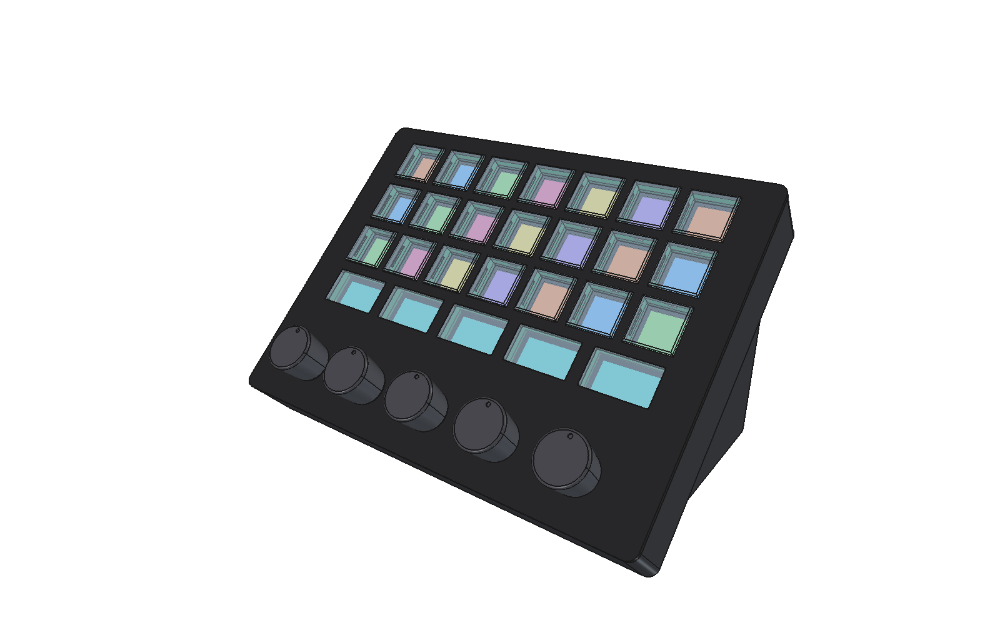
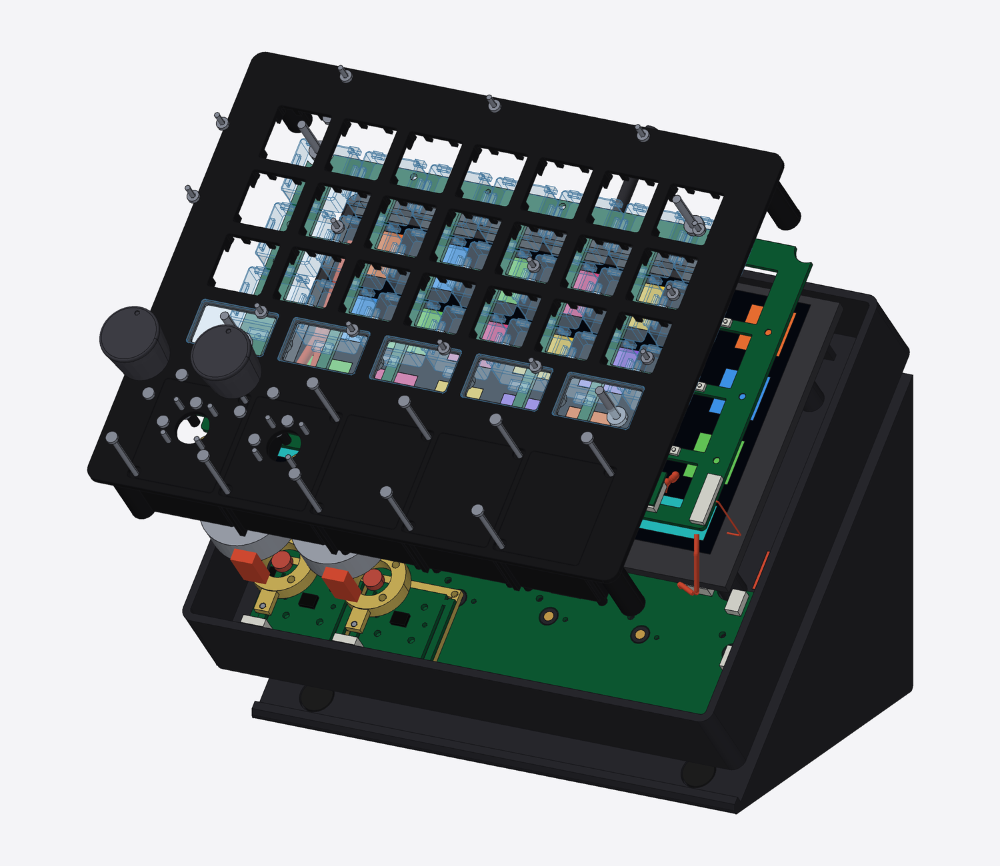
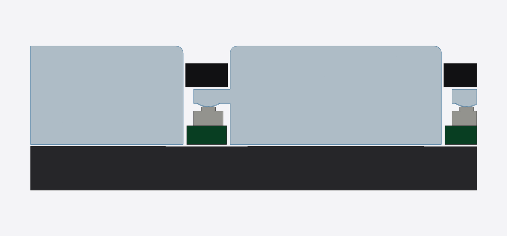
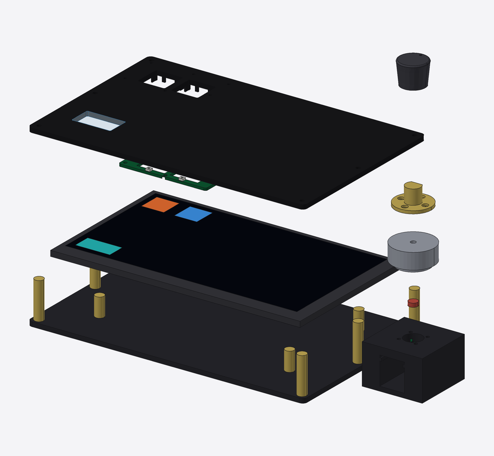
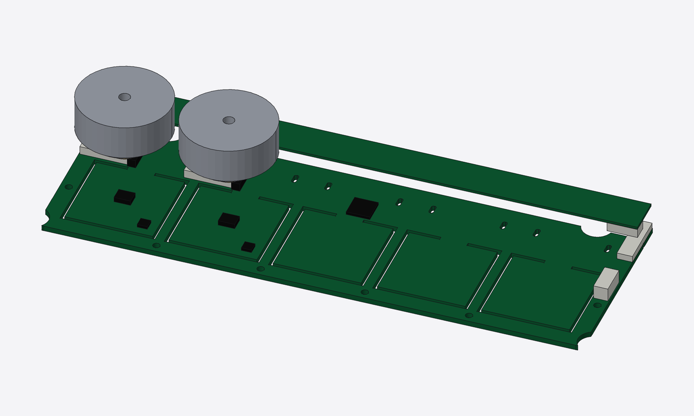

# clickdeck

A custom Stream Deck–style USB controller: per-key images, real clicky micro
switches, and motor-driven knobs that switch between clicky and smooth in
software.

## Why not just buy a Stream Deck + XL?

What this adds:
- **Programmable knobs.** Each knob switches per function between clicky,
  smooth, a set number of clicks, or hard end stops, and can push back
  (a tick at a preset, a nudge for attention). Stream Deck dials have one
  fixed feel.
- **Clicky keys.** Micro switches instead of soft rubber pads.
- **Open and Linux-first.** Open hardware, open USB protocol, your own
  firmware. No vendor app or account.

What the + XL does better: it's polished and ready today, has a huge plugin
library, 36 keys plus a touch strip, and costs about the same (see below). Build this for the knobs and the switch feel; if those don't matter,
buy the + XL.

## Cost (rough estimates)

| | ~Cost |
|---|---|
| **Build one, with your own 3D printer** | **$205–340** |
| Build one, case ordered from JLC3DP | $235–420 |
| Per unit, 5 people ordering together | $160–330 |
| Stream Deck + XL, for comparison | ~$350 |

Covers parts, PCBs (JLC's 5-board minimum included), prints and shipping, in
two orders: JLC (all PCBs in one panel, plus prints) and AliExpress/Waveshare.
Breakdown: [docs/cost.md](docs/cost.md).

## Design

| Exploded | Key profile (cap, tab, switch) |
|---|---|
|  |  |

Prototype (2 keys + 1 knob, laser-cut acrylic):

Knob board (one PCB, five knobs). Each knob sits on a hinged tongue that
presses a switch underneath; motors lifted to show the tongues:

- [docs/plan.md](docs/plan.md): goals, architecture, and the staged build plan
- [docs/parts.md](docs/parts.md): prototype parts list with links
- [docs/cost.md](docs/cost.md): cost breakdown
- [docs/pcb.md](docs/pcb.md): how the PCBs get designed and ordered
- [cad/](cad/): parametric CAD (build123d). STEP files for FreeCAD/Fusion 360 in `cad/out/`

Status (2026-10-16): planning and CAD. Next step is reviewing the models,
then ordering the prototype parts.

## Related projects

Nothing else we found combines clicky keys, per-key images and haptic knobs.
These cover parts of it:

| Project | Keys | Per-key images | Knobs | What clickdeck takes from it |
|---|---|---|---|---|
| [Open Deck (joshr120)](https://github.com/joshr120/open-deck), MIT. Not the OpenDeck app | ✓ 4 keys, real switches | ✓ one 1.8" screen under acrylic caps | ✗ | Same key idea at small scale. Cap recipe: 4.5 mm acrylic, or laser-cut 1.5 + 3 mm layers glued with UV glue |
| [eezbotfun 8-key macropad](https://github.com/eezbotfun/8-key-macropad), case files CC BY-NC | ✓ mechanical | ✗ one 3.5" screen | ✗ | ESP32-S3 + HID reference |
| [Super Make Something DIY Stream Deck](https://make.co/contestants/diy-stream-deck/) | ✓ | ✓ LCD buttons | plain encoders | Reference for LCD keys |
| [SmartKnob](https://github.com/scottbez1/smartknob) | ✗ | ✗ | ✓ haptic, one knob with a round screen | Haptic firmware: detents, end stops, click profiles |
| Elgato Stream Deck Module 6/15/32 | rubber pads | ✓ | ✗ | Commercial LCD-key component, for comparison |
| [HAW Hamburg thesis (2026)](https://reposit.haw-hamburg.de/bitstream/20.500.12738/19952/1/BA_Entwicklung_eines_haptischen_Controllers.pdf) | Stream Deck module | ✓ | potentiometers | Similar goal, no haptics |

Software it builds on: [OpenDeck](https://github.com/nekename/OpenDeck) (runs
Stream Deck plugins), [SimpleFOC](https://simplefoc.com) (motor control).

## License

- Software (Python, scripts, firmware, host code): [MIT](LICENSE)
- Hardware designs (CAD models and exports in `cad/`, PCB designs, and the
  design docs in `docs/`): [CERN-OHL-P-2.0](LICENSE-HARDWARE)
