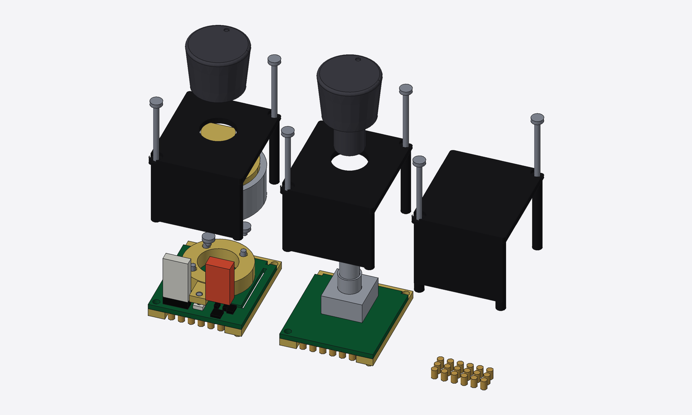

# clickdeck

> [!CAUTION]
> **This is AI-generated and completely untested.** Nothing here has been
> built, assembled, flashed or measured: not the CAD, not the PCBs, not the
> parts list, not the costs. It was produced by an AI assistant
> (Claude) during planning conversations, and it will contain mistakes.
> Treat every dimension, part number, price and claim as a guess until it's
> verified on real hardware. Don't order anything based on this without
> checking it yourself.

A custom USB macro controller: per-key images, real clicky micro switches,
and motor-driven knobs that switch between clicky and smooth in software.

The knobs are modules (D23). Each of the five knob slots takes a
**haptic** module (motor-driven), a cheaper **lite** module (a plain push
encoder, detented or smooth as ordered) or a blank. Modules lift out from
the top with the case closed, so you can start with one or two knobs and
add more later.

## Why not just buy a Stream Deck + XL?

What this adds:
- **Programmable knobs.** Each knob switches per function between clicky,
  smooth, a set number of clicks, or hard end stops, and can give a tick
  at a preset. They also press to click.
  Stream Deck dials have one fixed feel.
- **Clicky keys.** Micro switches instead of soft rubber pads. Caps move
  straight up and down, guided by the plate.
- **Set up in the browser, works anywhere.** A VIA-style web configurator
  (Chrome/Edge, over WebUSB) sets the key layout, shortcuts and macros,
  knob feel, images and firmware, and stores everything on the device. After
  that it works on any computer with no software installed. A small
  optional daemon adds live integrations: changing images, app state,
  scripts ([docs/configurator.md](docs/configurator.md)).
- **Open and Linux-first.** Open hardware, open USB protocol, your own
  firmware, and an easy way back to factory
  ([docs/recovery.md](docs/recovery.md)).

Like the + XL, it has a touch band under the knob displays for taps and
swipes.

What the + XL does better: it's polished and ready today, has 36 keys and
6 dials, has a big plugin library (clickdeck has none; OpenDeck or
Companion clients may come later), and it **costs less** (see below).
Build this for the knobs and the switch feel; if those don't matter, buy
the + XL.

## Cost (rough estimates)

| | Build one (own 3D printer) | 100 ordered together |
|---|---|---|
| Base device: display, keys, case, backplane, cables, no knobs | $345–540 | $125–180 |
| + haptic module, each | ~$20–27, plus ~$51–77 once per order | ~$16–21 |
| + lite module, each | ~$6–8, plus ~$39–50 once per order | ~$4–5 |
| **First build: 2 haptic + 3 blanks** | **$440–675** | $160–225 |
| All 5 haptic | $495–750 | $205–285 |
| Stream Deck + XL (36 keys, 6 dials), for comparison | ~$350 | |
| Development (designer's): test kit, tools, Rev A and one board revision | ~$715–1,280 | |

A case ordered from JLC3DP adds ~$35–75 to a single build. Nothing is
planned past one build until a device works. **A single build costs more
than a Stream Deck + XL.** Cost isn't what this
project optimizes, but the numbers try to be honest. They cover parts, PCBs
(JLC's 5-board minimum and 2-board assembly minimum included), prints,
ready-made internal cables, shipping and **US import duty** (the de minimis
exemption is gone; JLC's DDP duty is about 35% typical), in two orders:
JLC (the base boards in one panel, the module boards, prints) and AliExpress/Waveshare. Get a
real JLC quote before ordering. No crimping, and the goal is no soldering:
JLC fits every part, and every cable inside plugs in. The biggest costs
are JLC's boards (fees and parts), the duty, the motors and the display board.
Breakdown, with 5 and 25 units: [docs/cost.md](docs/cost.md); every part: [docs/bom.md](docs/bom.md).

## Design

| Exploded | Key profile (cap, tab, switch) |
|---|---|
|  |  |

Prototype (2 keys on the real 7B, a printed top plate on a laser-cut acrylic
base, plus a printed knob test stand with bought breakouts):

Inside, with the panel removed: Waveshare's board at the back, the
backplane and the knob slots across the front, the USB board (hub) in the back-left corner with the
USB-C port in the back wall:

Cabling from above (display and top plate removed): one USB-C cable in, a
hub on the USB board, a short USB-C cable to the display board and a
latching JST-GH cable to the backplane. Every cable is bought and plugged
in ([docs/wiring.md](docs/wiring.md)):

Knob modules (D23), lifted out of their slots: haptic, lite and a blank.
The backplane under the slots has 18 pogo pins per slot; they press gold
pads under each module. A haptic module's motor sits on a hinged tongue
cut into the module board; pressing the knob pushes an arm on the motor
spacer onto a switch on the board's front border. Two screws through the
cover hold each module. Both knob types sit at the same height (checked in
the model):

- [docs/assembly.md](docs/assembly.md): assembly and service guide, with pictures and an animation (generated from the CAD)
- [docs/plan.md](docs/plan.md): goals, architecture, and the staged build plan
- [docs/parts.md](docs/parts.md): prototype parts list with links (final parts bought early + a throwaway test kit)
- [docs/cost.md](docs/cost.md): cost breakdown
- [docs/bom.md](docs/bom.md): bill of materials, base device and each module (generated from the CAD)
- [docs/lessons.md](docs/lessons.md): lessons from related projects, so we don't relearn them
- [docs/wiring.md](docs/wiring.md): power path, cables and connectors, strain relief, key matrix, pin budget
- [docs/knob-module.md](docs/knob-module.md): the knob modules (haptic, lite, blank): mechanics, netlist, parts and design notes
- [docs/configurator.md](docs/configurator.md): web configurator, optional host daemon, Linux udev rule
- [docs/recovery.md](docs/recovery.md): recovery and factory reset (start here if something's stuck)
- [docs/protocol.md](docs/protocol.md): USB protocol draft (two USB devices behind a hub, WebUSB)
- [hardware/](hardware/): KiCad boards generated from the CAD
- [docs/open-questions.md](docs/open-questions.md): what's unverified, and how/when it gets answered
- [docs/prototype-tests.md](docs/prototype-tests.md): pass/fail tests for the prototype
- [docs/pcb.md](docs/pcb.md): how the PCBs get designed and ordered
- [cad/](cad/): parametric CAD (build123d). STEP files for FreeCAD/Fusion 360 in `cad/out/`

Status (2026-10-19): design stage, nothing built. Knobs are now modules
in five slots (D23): haptic, lite (push encoders, D22) or blank. Done on paper: CAD for
the full device and prototype (real Waveshare 7B dimensions), prototype
frame PCB (generated, DRC clean), knob channel spec, wiring/power spec
(internal USB hub, plug-in cables only), USB protocol draft, design review
with the owner's decisions ([docs/design-review.md](docs/design-review.md)).
Prototype plan (2026-10-18): buy the final parts early (7B, motors,
magnets), test the knob on bought breakouts and the keys on the rev C
frame PCB, then build Rev A, the first build of our own boards.
Next: order prototype parts ([docs/parts.md](docs/parts.md)), prototype
firmware, the web configurator and the Rev A schematics. Open items:
[docs/open-questions.md](docs/open-questions.md); pass/fail criteria:
[docs/prototype-tests.md](docs/prototype-tests.md).

## Related projects

Nothing else we found combines clicky keys, per-key images and haptic knobs.
These cover parts of it:

| Project | Keys | Per-key images | Knobs | What clickdeck takes from it |
|---|---|---|---|---|
| [Open Deck (joshr120)](https://github.com/joshr120/open-deck), MIT. Not the OpenDeck app | ✓ 4 keys, real switches | ✓ one 1.8" screen under acrylic caps | ✗ | Same key idea at small scale. Its acrylic caps (4.5 mm, or 1.5 + 3 mm layers glued with UV glue) are too loose in tolerance for clickdeck's key stack |
| [eezbotfun 8-key macropad](https://github.com/eezbotfun/8-key-macropad), case files CC BY-NC | ✓ mechanical | ✗ one 3.5" screen | ✗ | ESP32-S3 + HID reference |
| [Super Make Something DIY Stream Deck](https://make.co/contestants/diy-stream-deck/) | ✓ | ✓ LCD buttons | plain encoders | Reference for LCD keys |
| [SmartKnob](https://github.com/scottbez1/smartknob) | ✗ | ✗ | ✓ haptic, one knob with a round screen | Haptic firmware: detents, end stops, click profiles |
| Elgato Stream Deck Module 6/15/32 | rubber pads | ✓ | ✗ | Commercial LCD-key component, for comparison |
| [HAW Hamburg thesis (2026)](https://reposit.haw-hamburg.de/bitstream/20.500.12738/19952/1/BA_Entwicklung_eines_haptischen_Controllers.pdf) | Stream Deck module | ✓ | potentiometers | Similar goal, no haptics |

Software it builds on: [SimpleFOC](https://simplefoc.com) (motor control),
[esptool-js](https://github.com/espressif/esptool-js) (flashing the ESP32-S3
from the browser). The configurator follows the idea of
[VIA](https://www.caniusevia.com/) for keyboards.

## License

- Software (Python, scripts, firmware, host code): [MIT](LICENSE)
- Hardware designs (CAD models and exports in `cad/`, PCB designs, and the
  design docs in `docs/`): [CERN-OHL-P-2.0](LICENSE-HARDWARE)
