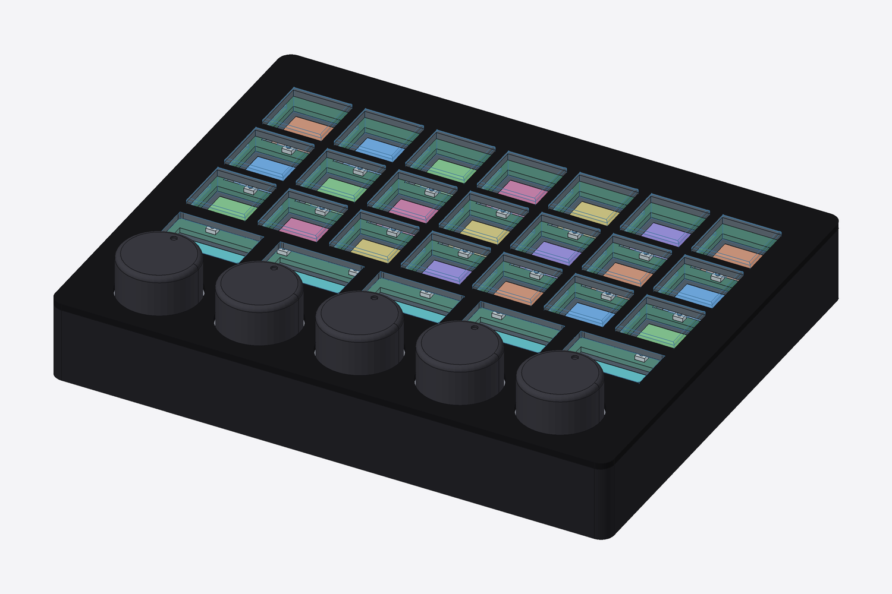

# clickdeck

A custom Stream Deck–style USB controller: per-key images, real clicky micro
switches, and motor-driven knobs that switch between clicky and smooth in
software.

| Exploded | Key profile (cap, tab, switch) |
|---|---|
|  |  |

Prototype (2 keys + 1 knob, laser-cut acrylic):

- [docs/plan.md](docs/plan.md): goals, architecture, and the staged build plan
- [docs/parts.md](docs/parts.md): prototype parts list with links
- [docs/pcb.md](docs/pcb.md): how the PCBs get designed and ordered
- [cad/](cad/): parametric CAD (build123d). STEP files for FreeCAD/Fusion 360 in `cad/out/`

Status (2026-10-16): planning and CAD. Next step is reviewing the models,
then ordering the prototype parts.
