# Assembly and service guide

> [!CAUTION]
> **Generated from the CAD model; nothing here has been built.** The pictures and
> checks come from `cad/assembly.py`, so they show the design as modeled, not a
> verified build. Expect the first real assembly to find problems the model can't.

Sharper version: [assembly.mp4](../cad/out/assembly/assembly.mp4).

## Model checks

Run on every build of this guide (`.venv/bin/python cad/assembly.py --check`). They
check the CAD model only: real parts, print tolerances and hands aren't in it, so a
pass here means "the model is consistent", not "it will build".

| Check | Result |
|---|---|
| Parts don't overlap in the finished device (screws only into their target; knob caps on their hubs only by the crush ribs' interference) | ✅ no overlaps |
| Screws: thread engagement within limits, tips stay inside their target, pilot holes run past the tips | ✅ 68 screws OK |
| Minimum gaps between mating parts (table below) | ✅ all met |
| Nothing floats: every part touches a chain of parts down to the tray | ✅ all supported |
| On the stand: nothing hits the stand, every foot is on the desk | ✅ clear |
| Every screw reachable with a straight screwdriver at its step | ✅ 68 of 68 screws reachable |
| Every plug slides straight into its socket at its step (plug bodies modeled at full size: USB-C overmold 12.5×6.5 mm) | ✅ 14 of 14 plugs |
| Cables clear every part (motor bells included); bends ≥ 10 mm on the USB-C cable; plate cables reach with the plate lifted 40 mm | ✅ all clear |
| Service: top plate, then display, then knob board lift straight out | ✅ all three lift out |
| A paperclip reaches BOOT and RESET through the back wall | ✅ both reachable |

Minimum gaps (nominal, from the model):

| Between | Gap | Min |
|---|---|---|
| motor bells ↔ top plate | 1.25 mm | 0.75 mm |
| knob hubs (flange, column) ↔ top plate | 0.50 mm | 0.40 mm |
| knob caps ↔ top plate | 1.00 mm | 0.50 mm |
| knob press switches ↔ strikers (set at calibration) | 0.20 mm | 0.15 mm |
| frame PCB ↔ glass (see D8) | 0.20 mm | 0.19 mm |
| key caps ↔ glass (see D8) | 0.20 mm | 0.19 mm |
| touch band ↔ frame PCB and its ZIF | 1.03 mm | 0.30 mm |
| touch band ↔ motor bells | 2.53 mm | 0.50 mm |
| display board ↔ USB board | > 3 mm | 0.50 mm |
| display board ↔ knob board | > 3 mm | 0.50 mm |

Screw engagement (thread length in the part it screws into):

| Screw | Into | Engaged | Allowed |
|---|---|---|---|
| M3x16 machine | panel tab (metal) | 1.7 mm | 1.5–2.2 mm |
| M2x5 thread-forming | top plate boss/post | 3.4 mm | ≥ 3 mm |
| M3x10 thread-forming | top plate boss/post | 8.8 mm | ≥ 6 mm |
| M2x8 machine | motor (base) | 1.4 mm | 1.2–2.5 mm |
| M2x3 countersunk machine | motor (bell) | 1.0 mm | 0.8–1.2 mm |
| M2x6 thread-forming | tray boss | 4.4 mm | ≥ 3 mm |

## Hardware

| Part | Qty | Used in step |
|---|---|---|
| M2x6 thread-forming | 4 | 2. Screw in the USB board |
| M2x8 machine | 20 | 3. Build the knob board (on the bench) |
| M2x3 countersunk machine | 20 | 3. Build the knob board (on the bench) |
| M2x6 thread-forming | 11 | 4. Screw the knob board into the tray; plug in the USB link |
| M3x16 machine | 4 | 5. Mount the display; plug in its USB cable |
| M2x5 thread-forming | 5 | 6. Build the top plate (on the bench) |
| M3x10 thread-forming | 4 | 7. Close the case |
| Hook-and-loop cable ties, ~10 mm wide (strap each motor lead coil through its two slots) | 5 | 3. Build the knob board (on the bench) |
| Magnets 8×1.5 mm (tray) | 4 | 1. Print the case; fit magnets, feet and press strikers |
| Magnets 8×3 mm (stand) | 4 | 9. Put it on the stand |
| Rubber feet 10×1.5 mm | 6 | 1. Print the case; fit magnets, feet and press strikers, 9. Put it on the stand |
| M2×3 set screws (press strikers) | 5 | 1. Print the case; fit magnets, feet and press strikers |
| Epoxy | — | magnets |

Thread-forming screws go into printed plastic (PT/WN 1411-style K30, K20, or ST2.9/ST2.2
DIN 7981 pan heads): drive them slowly and stop when snug.
Panel screws thread into the display's metal tabs (check the thread on the real
board; the drawing says M3).

### Cables

All bought ready-made and plugged in: nothing to solder or crimp. The length to buy
is the shortest common stock length that covers the modeled route (plug tip to plug
tip, plugs included) and, for the two cables to the top plate, the reach with the
plate lifted. The display cable's loop is sized for 100 mm; 95-110 mm cables fit.

| Cable | Connects | Buy | Route in the model | Step |
|---|---|---|---|---|
| USB-C to USB-C, USB 2.0 (3 A), one 90° side-exit end + one straight end | display board USB port ↔ USB board | **100 mm** | 98 mm | 5. Mount the display; plug in its USB cable |
| JST-GH 1.25 mm 8-pin, plugs both ends, pin 1 to pin 1 ("same direction"), 26 AWG | USB board ↔ knob board | **100 mm** | 74 mm | 4. Screw the knob board into the tray; plug in the USB link |
| FFC, 12-pin, 1.0 mm pitch, contacts on opposite sides (type B) | frame PCB ↔ knob board | **80 mm** | 24 mm; 70 mm with the plate lifted 40 mm | 6. Build the top plate (on the bench) |
| JST-SH 1.0 mm 6-pin, plugs both ends, pin 1 to pin 1 | touch band ↔ knob board | **80 mm** | 37 mm; 69 mm with the plate lifted 40 mm | 6. Build the top plate (on the bench) |
| Motor leads (on the motors) | motor ↔ knob board header | 300 mm assumed | ~37 mm routed; the rest coils on the back strip (6.6 mm high, 11.7 mm room) | 3. Build the knob board (on the bench) |

Pinouts and the strain-relief measures: [wiring.md](wiring.md). Every part with
sources: [bom.md](bom.md).

## Assembly

### 1. Print the case; fit magnets, feet and press strikers

Print the tray, top plate and stand (all fit a 256 mm bed) in PETG or ASA, 4 walls, ≥25% infill (100% over the touch band area of the top plate; no carbon- or metal-filled filament). Glue the four tray magnets into the pockets underneath. Stick the two rubber feet near the front edge (for flat use; on the stand they sit in pockets). Thread an M2×3 set screw up through each of the five holes under the knob press switches until its tip stands ~0.4 mm above the floor: these are the press strikers, set finally during calibration (step 4).

### 2. Screw in the USB board

Lower the USB board into the back-left corner, external USB-C socket first: the socket's face sits flush behind the opening in the back wall, the board's arm rests against the printed backstop, and its edge touches the back wall. Drive the four M2 screws into the floor bosses (two of them either side of the socket). The hub chip sits on the arm next to the socket, so the high-speed upstream run is short.

### 3. Build the knob board (on the bench)

Glue a diametric magnet to the bottom end of each motor shaft. Set a printed spacer ring on each tongue (its two pins drop into the holes beside the MT6701 and center the motor, so the magnet sits within 0.3 mm of the sensor axis), put the motor on it with its lead pointing back, and drive four M2×8 screws up from under the tongue into the motor base. Never use longer screws: a tip past the base's thread can short a winding. Screw a printed hub onto each bell with four M2×3 countersunk screws (its spigot centers it in the shaft bore). Plug each motor's 3-pin plug onto the header behind its tongue (any way round: the firmware finds the phase order), coil the spare lead flat on the back strip and strap it through the two slots with a hook-and-loop tie. Keep the lead clear of the bell. Calibrate each knob now, before it's buried in the case.

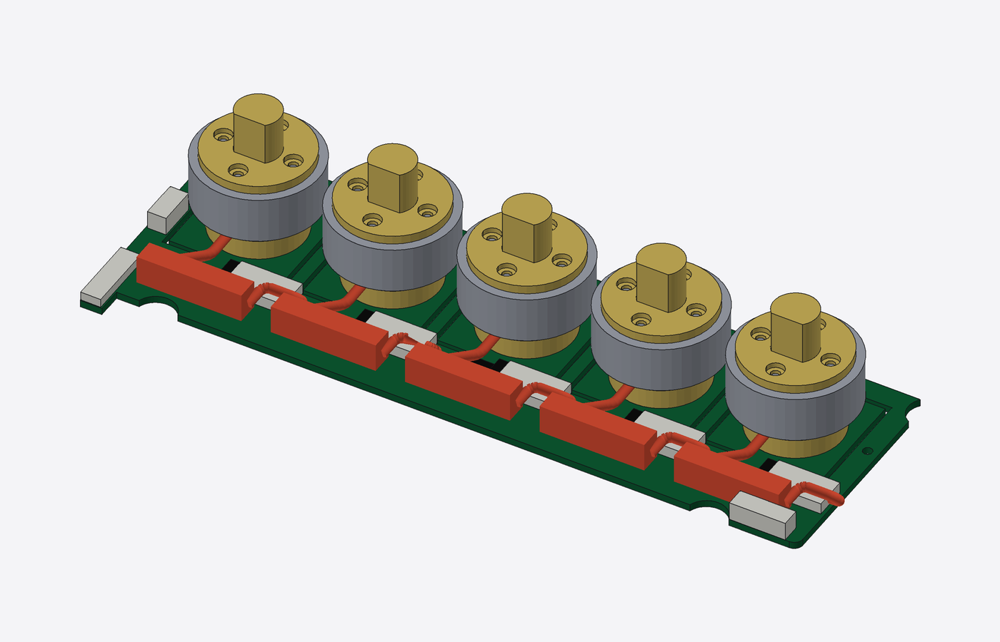

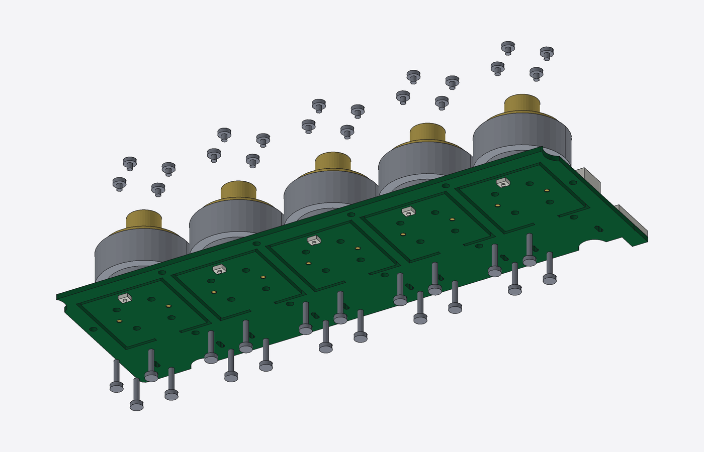

### 4. Screw the knob board into the tray; plug in the USB link

With the PC unplugged: lower the knob board in with its back strip resting on the floor ribs, and screw it down along its front edge and behind each hinge into the floor bosses (thread-forming, don't overtighten). Before the first power-up, check the JST-GH cable pin 1 to pin 1 with a meter. Plug it into the knob board's back-left corner and into the USB board (both click), and press it into its floor clip. To set the press strikers, turn each set screw from below until the knob clicks after a light press, then back it off a quarter turn.

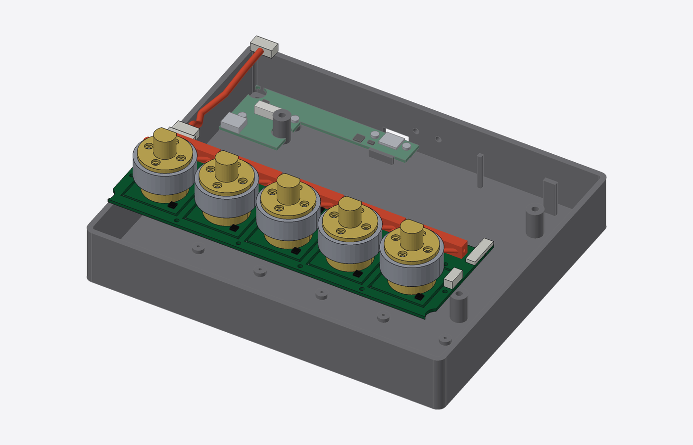

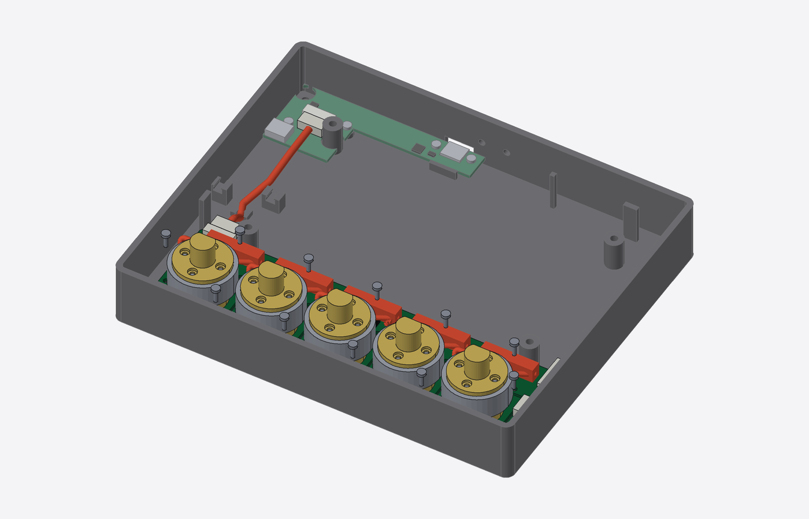

### 5. Mount the display; plug in its USB cable

Stand the tray upright on two blocks (~50 mm high) under its left and right walls, so screws can go in from below without turning it over. Lay the panel face up on its four posts, against the three printed stops behind and beside it, and drive the four M3 screws up from underneath into the panel's tabs (the tip ends ~2 mm past the tab face, short of the LCD's back sheet: don't substitute longer screws). Plug the right-angle end of the USB-C cable into the display board's USB port (the one nearer the back; the cable points forward), loop it round in the bay and plug the straight end into the USB board. Press the cable into its two floor clips, clear of the knob board.

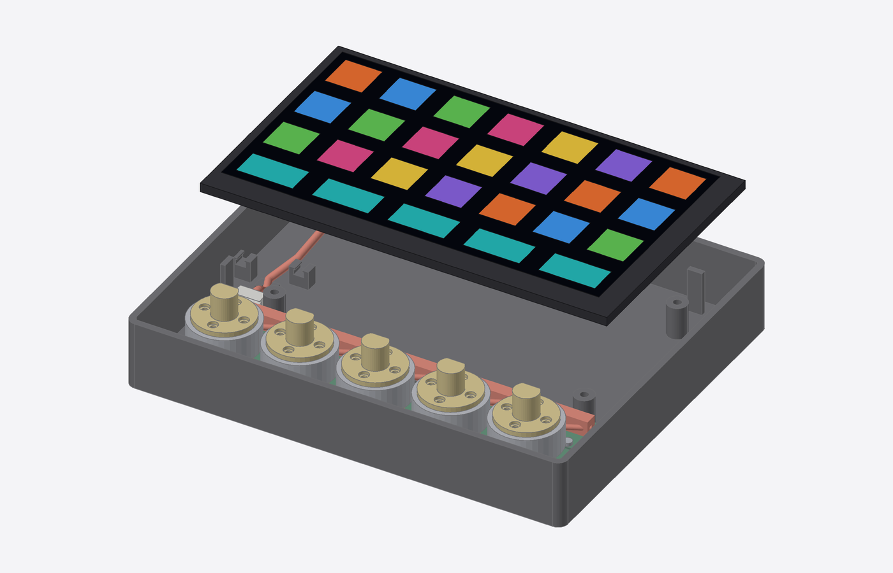

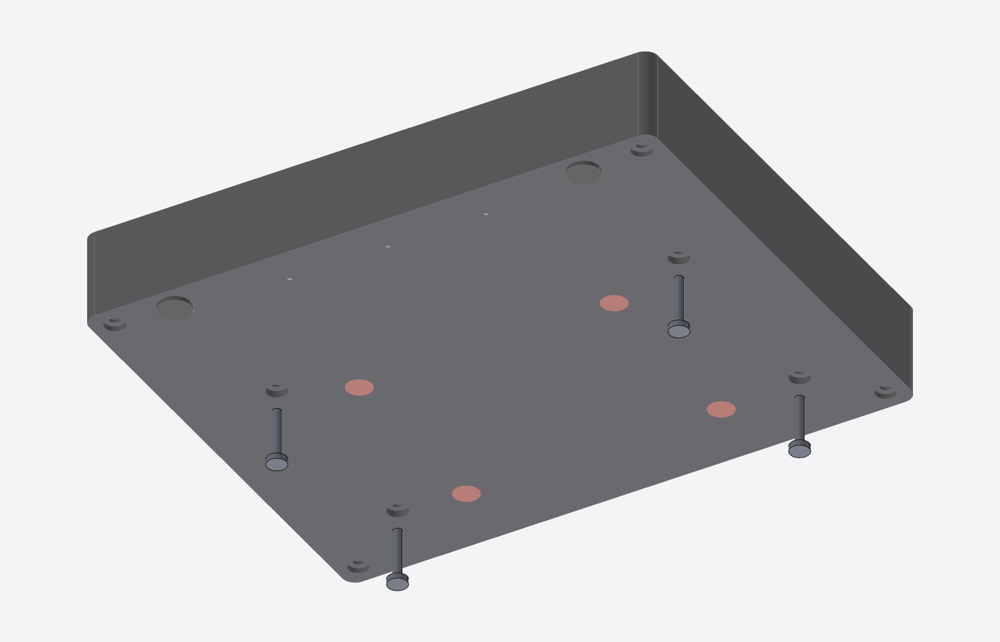

### 6. Build the top plate (on the bench)

With the top plate face up, drop the five clear knob-window covers into their pockets (they rest on a ledge) and fix each with a little clear UV glue or clear tape on the ledge. Lay the plate face down. Drop the clear caps into their holes, tabs toward the front edge. Plug the key cable (FFC) into the frame PCB's ZIF connector (flip the latch up, slide the cable in, latch down), then fit the frame PCB over the plate's two locating pins (switches facing the caps) and screw it to the bosses. Stick the touch band into its pocket under the plate, below the knob display windows, with full-coverage 3M 467MP/468MP transfer tape (no air gaps), and plug the touch cable into it.

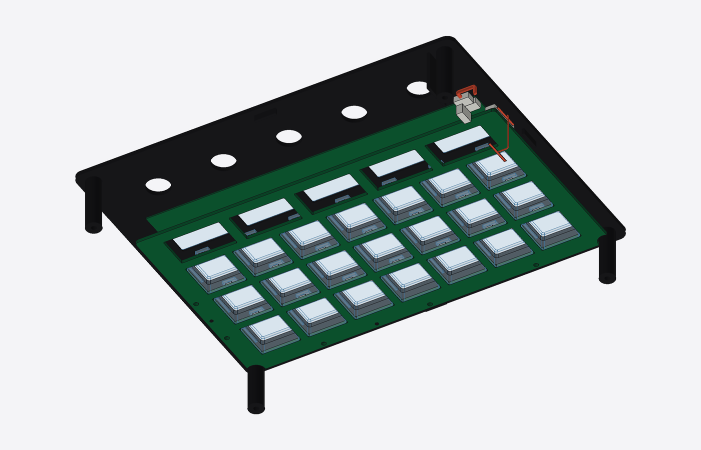

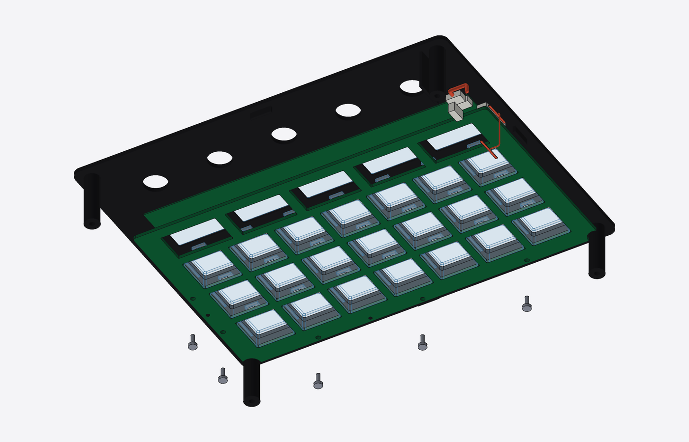

### 7. Close the case

With the PC unplugged: shake out any loose screws or debris. Rest the top plate on the two printed props (`print_plate_prop.stl`) on the tray's walls, which hold it ~40 mm up with its cables plugged in. Plug the key cable into the knob board's ZIF connector at its right end and the touch cable into the header beside it; the spare cable folds into the gap by the right wall, outside the fence next to knob 4. Take the props out and lower the top plate over the knob hubs (its tabs register it inside the walls). With the tray still on its blocks, drive the four M3 screws up from underneath into its posts.

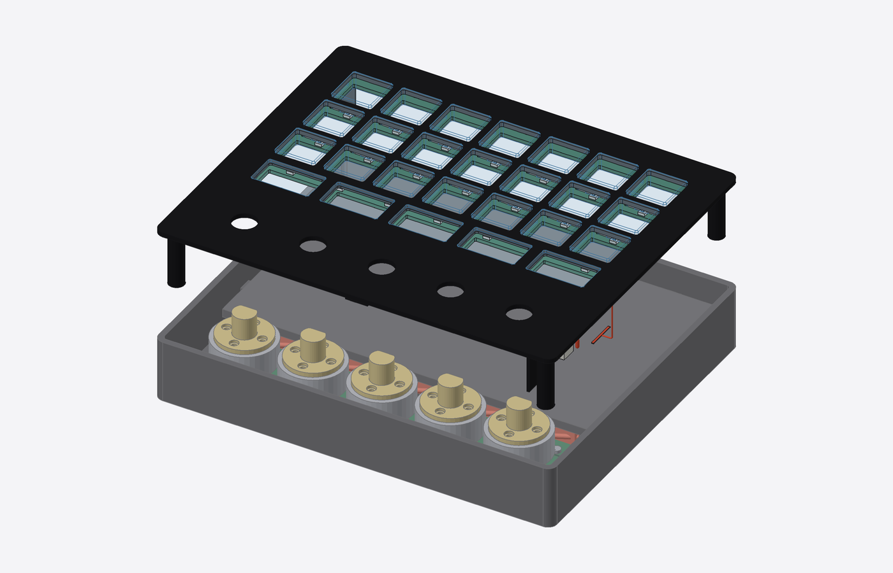

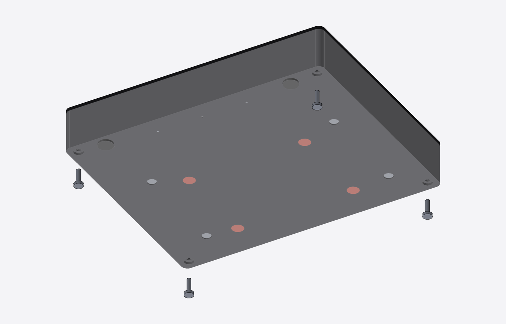

### 8. Press on the knob caps

Press each knob cap onto its hub. They pull straight off for service.

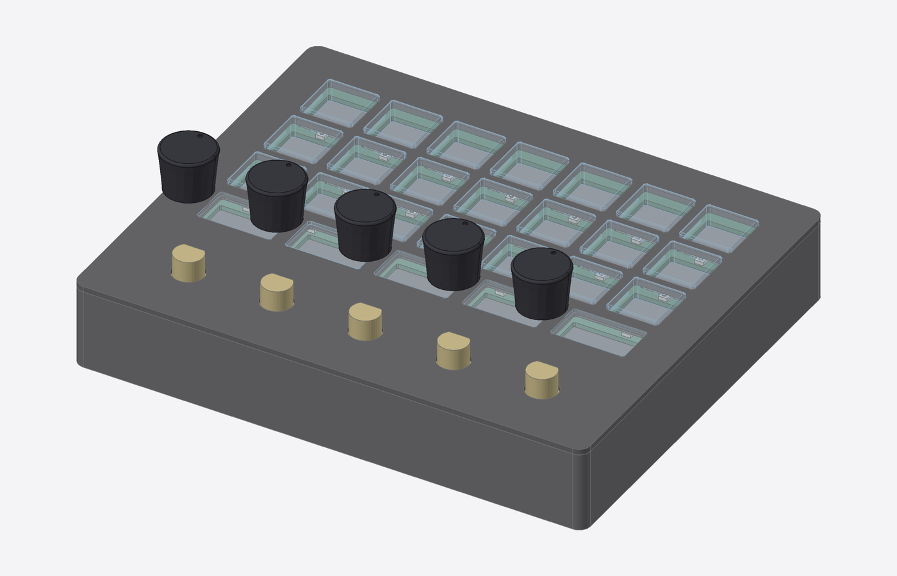

### 9. Put it on the stand

To get the polarity right, stack each stand magnet on its mating tray magnet (so they attract), mark the stand magnet's exposed face, and glue it into the stand with that marked face down (away from the tray). Stick the four feet on the stand's corner blocks. Set the slab on the stand: its front edge drops behind the stand's lip, which carries it, and the magnets locate it.

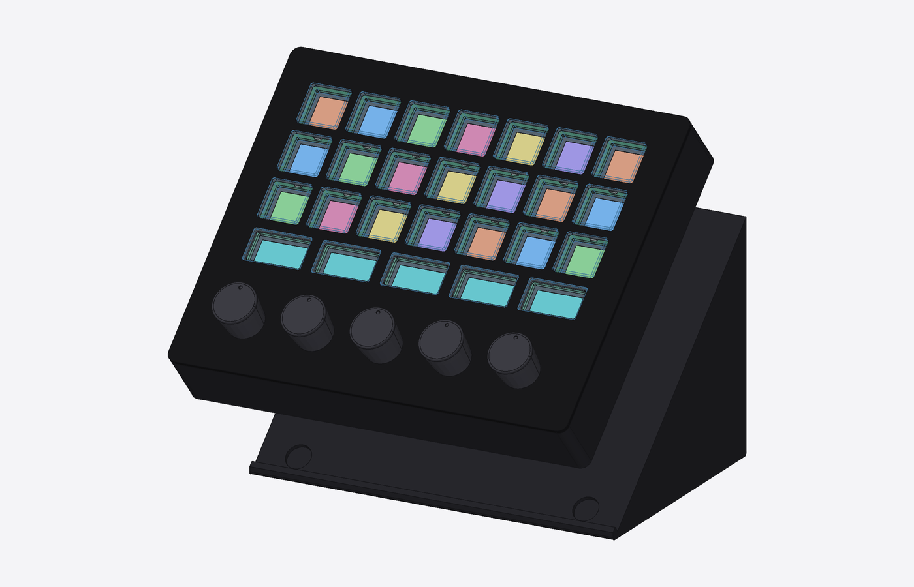

### 10. Plug it in

Plug a USB-C cable from the computer into the port in the back wall. A C-to-C cable lets the device see how much current the port offers; an A-to-C cable works too, with weaker haptics (500 mA budget).

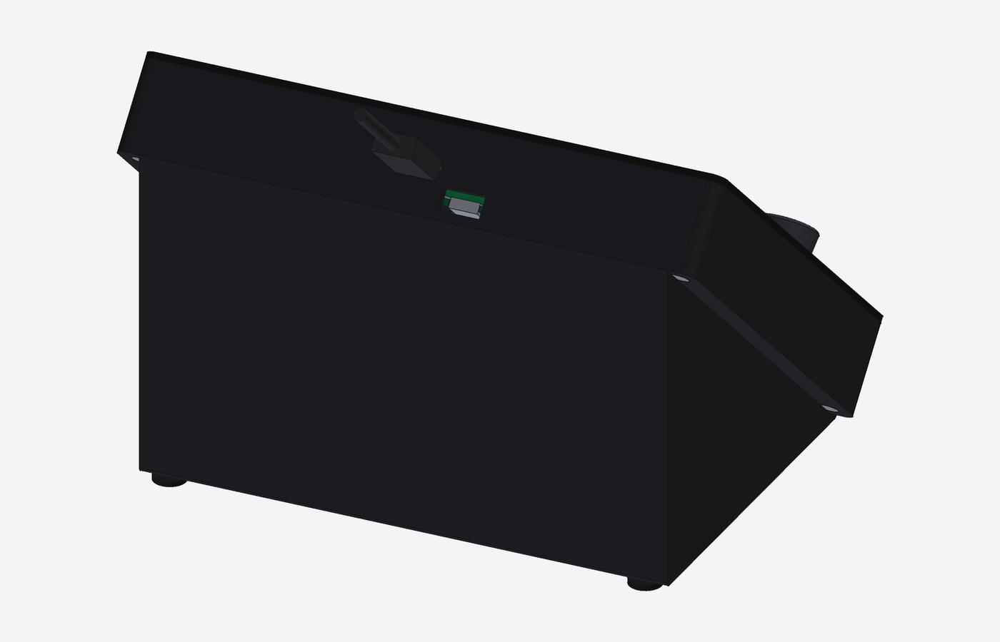

## Service

### Open the case

1. Pull the slab off the stand (magnets).
2. Pull the five knob caps straight up.
3. Undo the four M3 screws under the tray (the top plate's posts).
4. Lift the top plate straight up, with the caps, frame PCB and touch band on it.
   Its two cables reach 40 mm; at that height unplug them at the knob
   board's right end (flip the ZIF latch up to free the key cable; pull the touch
   plug straight up).

### Swap a key cap or switch

With the top plate off and face down, undo the frame PCB's screws, lift the PCB
and replace the cap or switch.

### Recover the display board's firmware

No need to open the case: unplug the USB cable, hold BOOT through its hole in the back
wall with a paperclip, and plug the cable back in; the board comes up in its ROM
bootloader on the native port. (RESET alone doesn't reset the board's IO expander;
firmware must never drive EXIO5 high, which switches the native USB port to CAN.)
Don't fit a battery to the 7B's J3, and unplug the back cable before using the
7B's UART port: either one would feed 5 V back into the hub and the PC.

### Recover the knob board's firmware

The knob board has its own USB connection through the hub, so the host app reboots
it into the RP2350B's built-in bootloader and copies a UF2 file. If the firmware is
too broken for that, open the case, hold the BOOTSEL button on the knob board and
unplug/replug the USB cable at the back: it shows up as a USB drive.

### Replace a motor or the knob board

Open the case (PC unplugged). Unplug the USB-C cable at the display board, remove the display
(four M3 screws from underneath), unplug the JST-GH cable at the knob board (press
the latch), then undo the knob board's screws along its front edge and lift it out.
Its back strip sits under the display, which is why the display comes out first.
A motor unplugs from its header; cut its hook-and-loop tie free.

