# Assembly and service guide

> [!CAUTION]
> **Generated from the CAD model; nothing here has been built.** The pictures and
> checks come from `cad/assembly.py`, so they show the design as modeled, not a
> verified build. Expect the first real assembly to find problems the model can't.

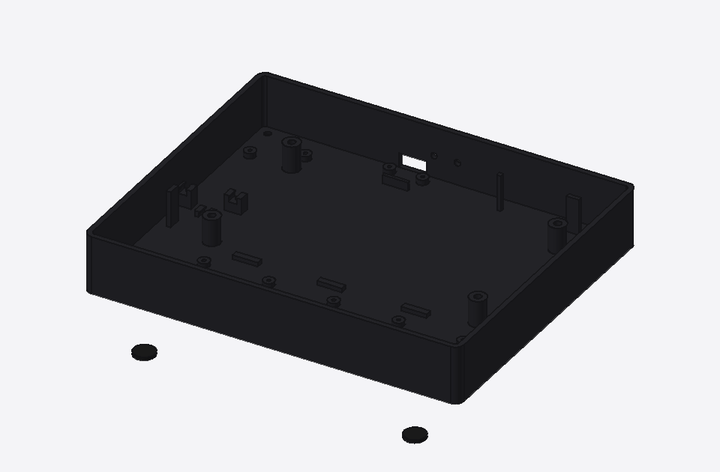

Sharper version: [assembly.mp4](../cad/out/assembly/assembly.mp4).

## Build checks

Run on every build of this guide (`.venv/bin/python cad/assembly.py --check`).

| Check | Result |
|---|---|
| Parts don't overlap in the finished device | ✅ no overlaps |
| Every screw reachable with a straight screwdriver at its step | ✅ 19 of 19 screws reachable |
| Service: top plate, then display, then knob board lift straight out | ✅ all three lift out |
| A paperclip reaches BOOT and RESET through the back wall | ✅ both reachable |

## Hardware

| Part | Qty | Used in step |
|---|---|---|
| M2x5 self-tapping | 6 | 3. Screw the knob board into the tray |
| M3x14 machine | 4 | 4. Mount the display |
| M2x5 self-tapping | 5 | 5. Build the top plate (on the bench) |
| M3x10 self-tapping | 4 | 6. Close the case |
| Motor mounting screws (usually supplied with the 2204; check length vs the 1.6 mm board) | 5 sets | 2. Build the knob board (on the bench) |
| Magnets 8×1.5 mm (tray) | 4 | 1. Print the case; fit magnets and front feet |
| Magnets 8×3 mm (stand) | 4 | 8. Put it on the stand |
| Rubber feet 10×1.5 mm | 6 | 1. Print the case; fit magnets and front feet, 8. Put it on the stand |
| Epoxy | — | knob hubs, magnets |

Self-tapping screws go into printed plastic: drive them slowly and stop when snug.
Panel screws thread into the display's metal tabs (check the thread on the real
board; the drawing says M3).

### Cables

Lengths from the model's routing plus ~30 mm slack, rounded up.

| Cable | Length |
|---|---|
| cable_link | ~80 mm |
| cable_keys_ffc | ~80 mm |
| cable_touch | ~60 mm |

`cable_link` is three HY2.0 leads (UART2 4-pin, GPIO 3-pin, POWER 2-pin) bundled;
`cable_keys_ffc` is a 12-pin 1.0 mm FFC; `cable_touch` is a 6-pin JST-SH lead.
Pinouts: [wiring.md](wiring.md).

## Assembly

### 1. Print the case; fit magnets and front feet

Print the tray, top plate and stand (all fit a 256 mm bed). Glue the four tray magnets into the pockets underneath (check polarity against the stand's magnets first) and stick the two rubber feet near the front edge.

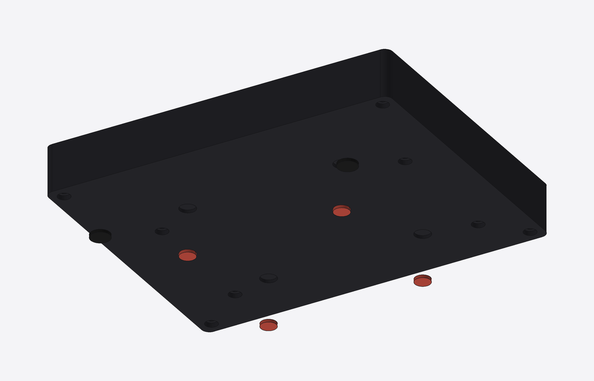

### 2. Build the knob board (on the bench)

Glue a diametric magnet to the bottom end of each motor shaft. Screw each motor's base to its tongue on the knob board, centered over the MT6701. Bond a printed hub to the top of each motor bell (epoxy, or M2 screws if the bell has holes). Calibrate each knob now, before it's buried in the case.

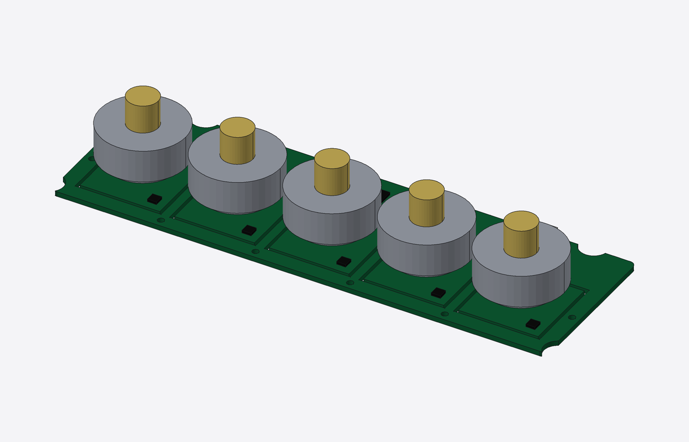

### 3. Screw the knob board into the tray

Lower the knob board in with its back strip resting on the floor ribs, and screw it down along its front edge into the floor bosses (self-tapping, don't overtighten). Plug the link, reset and power cable into the knob board.

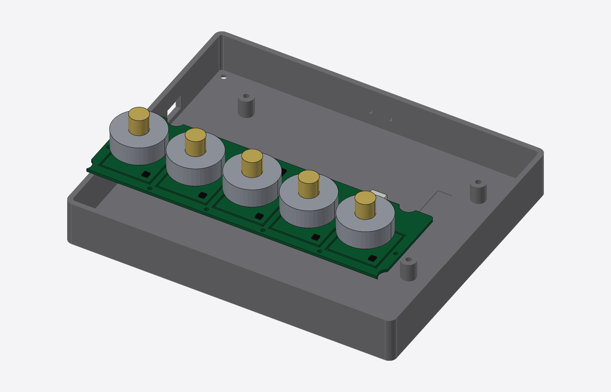

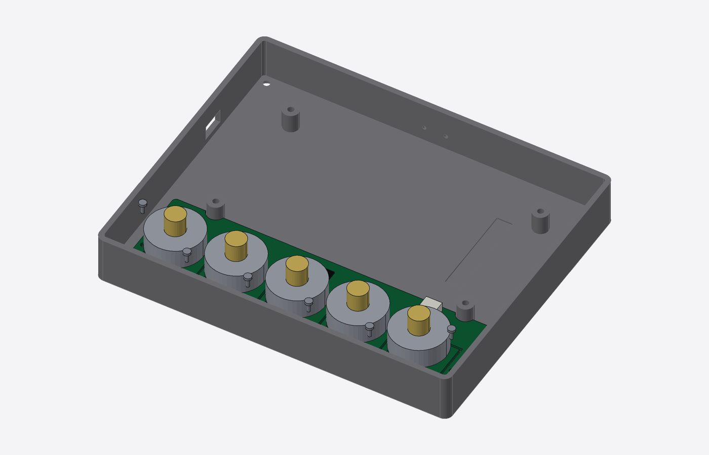

### 4. Mount the display

On Waveshare's board, set the UART2/UART1 slide switch to UART2 and plug in the link, reset and power cable (UART2, GPIO and POWER connectors). Lay the panel face up on its four posts, then turn the tray on its side and drive the four M3 screws up from underneath into the panel's tabs.

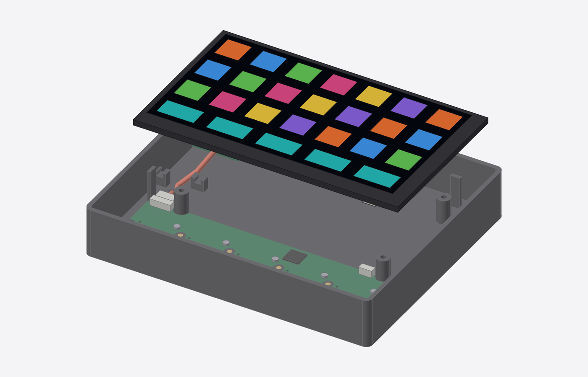

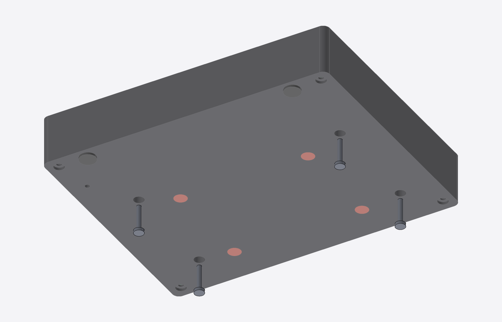

### 5. Build the top plate (on the bench)

Lay the top plate face down. Drop the clear caps into their holes, tabs toward the front edge. Screw the frame PCB onto the plate's bosses (switches facing the caps). Stick the touch band under the plate below the knob display windows and plug its cable and the key cable (FFC) into it and the frame PCB.

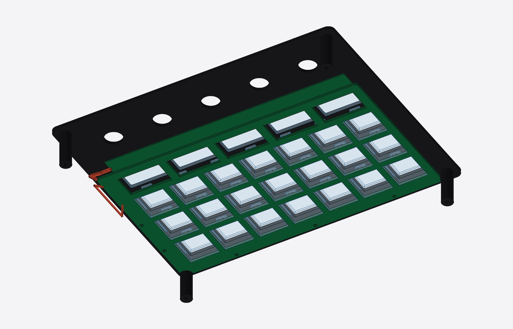

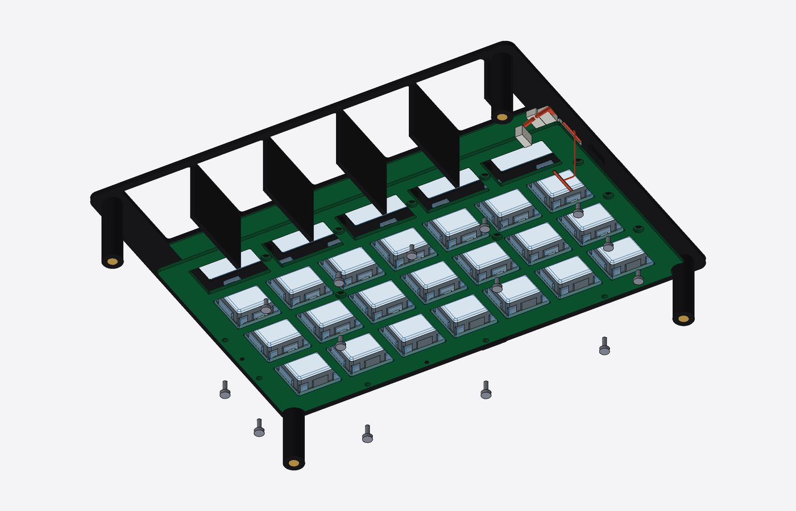

### 6. Close the case

Plug the key cable and the touch cable into the knob board. Lower the top plate over the knob hubs, then drive the four M3 screws up from underneath into its posts.

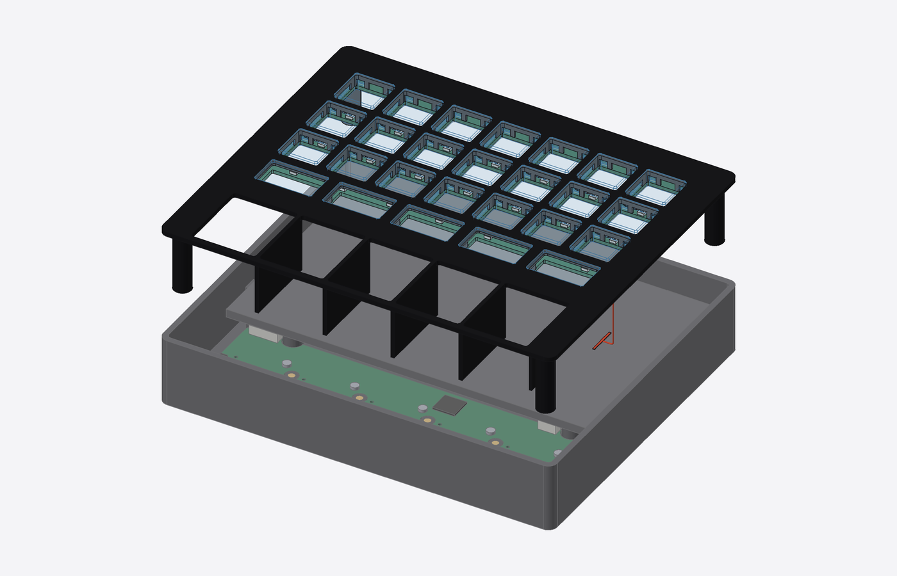

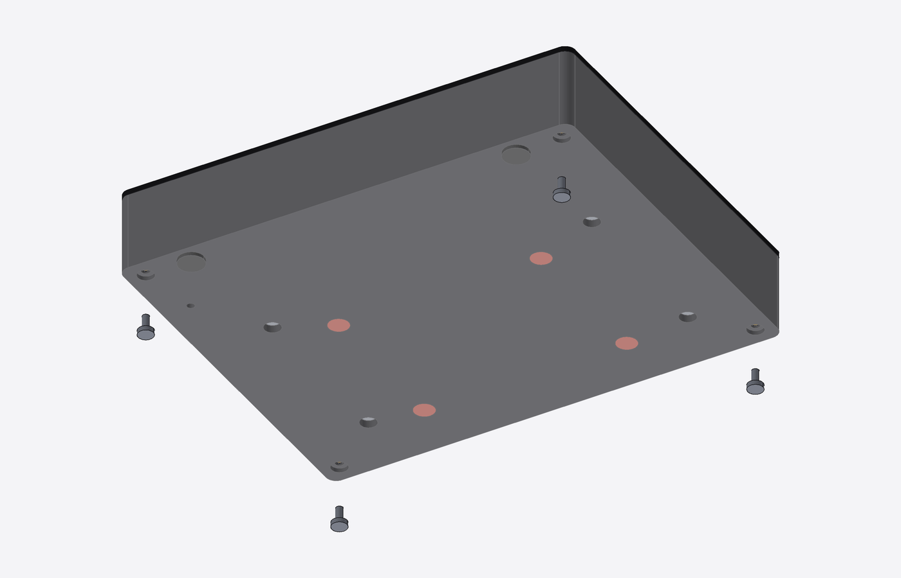

### 7. Press on the knob caps

Press each knob cap onto its hub. They pull straight off for service.

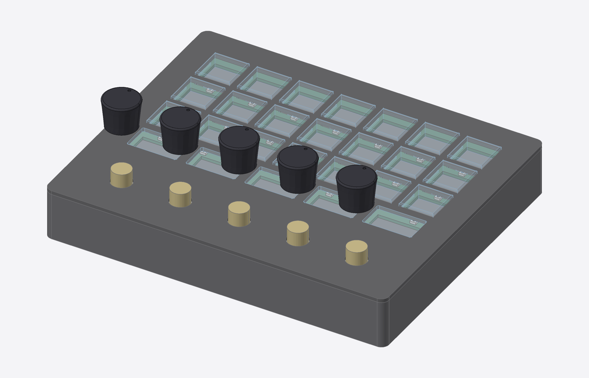

### 8. Put it on the stand

Glue the stand's magnets in (opposite polarity to the tray's) and stick its four feet on. The slab snaps onto the stand with the magnets.

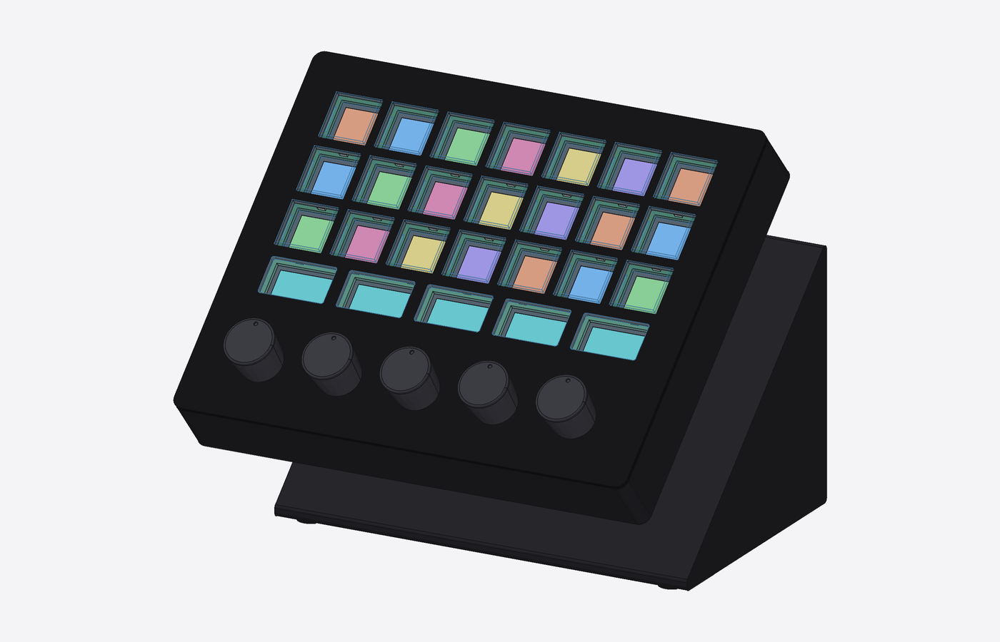

## Service

### Open the case

1. Pull the slab off the stand (magnets).
2. Pull the five knob caps straight up.
3. Undo the four M3 screws under the tray (the top plate's posts).
4. Lift the top plate straight up, with the caps, frame PCB and touch band on it,
   and unplug the key and touch cables from the knob board.

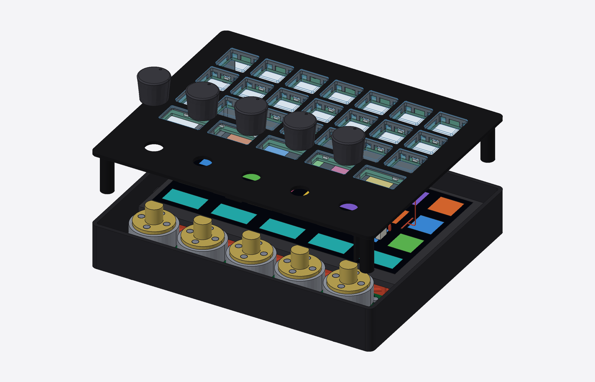

### Swap a key cap or switch

With the top plate off and face down, undo the frame PCB's screws, lift the PCB
and replace the cap or switch.

### Recover the display board's firmware

No need to open the case: press BOOT (hold) and RESET through the two small holes
in the back wall with a paperclip, then flash over USB.

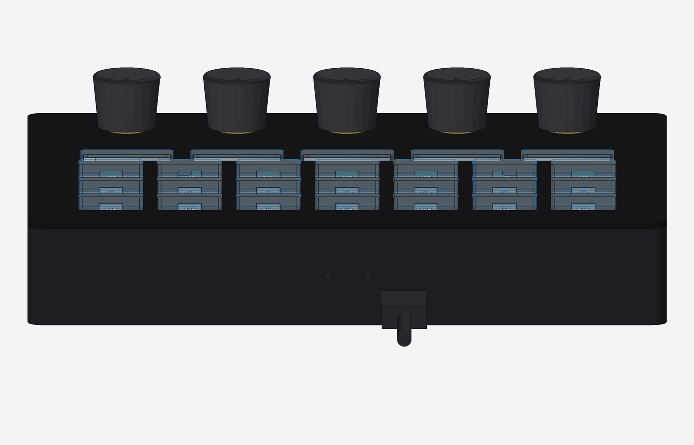

### Recover the knob board's firmware

Normally the display board updates it over the link cable. If that fails, open
the case: the knob board's recovery USB pads and BOOTSEL button are at its left
end.

### Replace a motor or the knob board

Open the case, remove the display (four M3 screws from underneath, unplug the
link cable), then undo the knob board's screws along its front edge and lift it
out. Its back strip sits under the display, which is why the display comes out
first.

