# Assembly and service guide

> [!CAUTION]
> **Generated from the CAD model; nothing here has been built.** The pictures and
> checks come from `cad/assembly.py`, so they show the design as modeled, not a
> verified build. Expect the first real assembly to find problems the model can't.

Sharper version: [assembly.mp4](../cad/out/assembly/assembly.mp4).

## Model checks

Run on every build of this guide (`.venv/bin/python cad/assembly.py --check`). They
check the CAD model only: real parts, print tolerances and hands aren't in it, so a
pass here means "the model is consistent", not "it will build".

| Check | Result |
|---|---|
| Parts don't overlap in the finished device (screws only into their target; knob caps on their hubs only by the crush ribs' interference) | ✅ no overlaps |
| Screws: thread engagement within limits, tips stay inside their target, pilot holes run past the tips | ✅ 59 screws OK |
| Minimum gaps between mating parts (table below) | ✅ all met |
| Nothing floats: every part touches a chain of parts down to the tray | ✅ all supported |
| On the stand: nothing hits the stand, every foot is on the desk | ✅ clear |
| Every screw reachable with a straight screwdriver at its step | ✅ 59 of 59 screws reachable |
| Every plug slides straight into its socket at its step (plug bodies modeled at full size: USB-C overmold 12.5×6.5 mm) | ✅ 11 of 11 plugs |
| Cables clear every part (motor bells included); bends ≥ 10 mm on the USB-C cable; plate cables reach with the plate lifted 40 mm | ✅ all clear |
| Service: each slot's module or blank lifts straight out with the case closed (D23); top plate, then display, then backplane lift straight out | ✅ all lift out |
| Knob slots (D23): knob tops within 0.05 mm of the haptic knob's position, covers and blanks flush with the plate, pogo pins compressed 0.50 mm (stroke 1 mm) and each on a pad; also checked with every slot haptic and every slot lite | ✅ all match |
| A paperclip reaches BOOT and RESET through the back wall, and BOOTSEL through the floor | ✅ all three reachable |
| Key stack (D8): every cap's down-stop lands on the frame PCB, and the worst cap drop plus the frame's flex at a 3 N press stays 0.1 mm off the glass. Cap guide (B3): every key has its guide skirt on all four sides; the worst drop counts the guide's tilt, and the down-stop keeps the cap 0.1 mm off the glass | ✅ clear of the glass (full build and prototype) |

Key stack (D8), from `cad/keystack.py`:

| | Full build | Prototype |
|---|---|---|
| Cap guide: clearance per side, engagement | 0.05 mm, 5.1 mm | 0.05 mm, 6.1 mm |
| Max cap tilt in the guide (slop, not a feature) | 1.17° | 0.96° |
| Cap bottom ↔ glass at rest | 0.80 mm | 0.80 mm |
| Down-stop gap (cap feet ↔ frame PCB) | 0.50 mm | 0.50 mm |
| Worst cap-edge drop, any press, PCB rigid (guide tilt + switch bottomed + down-stop) | 0.51 mm | 0.49 mm |
| Glass margin after that drop (need 0.1 mm) | 0.29 mm | 0.31 mm |
| Frame PCB flex at the worst switch (grillage) | 0.046 mm/N | 0.009 mm/N |
| Cap drop + flex at 3 N | 0.64 mm | 0.52 mm |
| Same at a hard 5 N press | 0.74 mm | 0.53 mm |

Minimum gaps (nominal, from the model):

| Between | Gap | Min |
|---|---|---|
| motor bells ↔ module covers (bezel above) | 2.25 mm | 0.75 mm |
| motor bells ↔ top plate (slot dividers beside them) | 0.67 mm | 0.50 mm |
| knob hubs (flange, column) ↔ covers | 0.50 mm | 0.40 mm |
| knob caps ↔ top plate and covers | 1.00 mm | 0.50 mm |
| knob press switches ↔ strikers (set at calibration) | 0.20 mm | 0.15 mm |
| modules and blanks ↔ top plate (openings, dividers) | 0.30 mm | 0.25 mm |
| pogo pins ↔ module bases and blanks (D23) | 0.50 mm | 0.30 mm |
| encoder shafts ↔ covers | > 3 mm | 0.50 mm |
| encoder pins (trimmed) ↔ backplane | > 3 mm | 0.30 mm |
| frame PCB ↔ glass (D8) | 0.80 mm | 0.79 mm |
| key caps ↔ glass, at rest (D8) | 0.80 mm | 0.79 mm |
| countersunk frame screws ↔ glass | 0.80 mm | 0.79 mm |
| pan-head frame screws ↔ panel edge (off the glass) | 0.60 mm | 0.50 mm |
| display board ↔ USB board | > 3 mm | 0.50 mm |
| display board ↔ backplane | 9.67 mm | 0.50 mm |

Screw engagement (thread length in the part it screws into):

| Screw | Into | Engaged | Allowed |
|---|---|---|---|
| M3x16 machine | panel tab (metal) | 1.7 mm | 1.5–2.2 mm |
| M2x5 thread-forming | top plate boss | 3.4 mm | ≥ 3 mm |
| M2x5 countersunk thread-forming | top plate boss | 3.4 mm | ≥ 3 mm |
| M3x6 machine | heat-set insert (top plate post) | 4.8 mm | 3–5.4 mm |
| M2x5 thread-forming | tray boss | 3.4 mm | ≥ 3 mm |
| M2x8 machine | motor (base) | 1.4 mm | 1.2–2.5 mm |
| M2x3 countersunk machine | motor (bell) | 1.0 mm | 0.8–1.2 mm |
| M2x30 countersunk machine | heat-set insert (slot boss) | 3.0 mm | 2.5–3.7 mm |
| M2x6 thread-forming | tray boss | 4.4 mm | ≥ 3 mm |

## Hardware

| Part | Qty | Used in step |
|---|---|---|
| M2x6 thread-forming | 4 | 2. Screw in the USB board |
| M2x5 thread-forming | 7 | 3. Screw in the backplane; plug in the USB link |
| M3x16 machine | 4 | 4. Mount the display; plug in its USB cable |
| M2x5 thread-forming | 5 | 5. Build the top plate (on the bench) |
| M2x5 countersunk thread-forming | 9 | 5. Build the top plate (on the bench) |
| M3x6 machine | 4 | 6. Close the case |
| M2x8 machine | 8 | 7. Build the knob modules (on the bench) |
| M2x3 countersunk machine | 8 | 7. Build the knob modules (on the bench) |
| M2x30 countersunk machine | 10 | 8. Drop in the knob modules and blanks; screw them down |
| Magnets 8×1.5 mm (tray) | 4 | 1. Print the case; fit magnets, feet and inserts |
| Magnets 8×3 mm (stand) | 4 | 10. Put it on the stand |
| Rubber feet 10×1.5 mm | 6 | 1. Print the case; fit magnets, feet and inserts, 10. Put it on the stand |
| M2×3 set screws (press strikers, in the spacer arms) | 2 | 7. Build the knob modules (on the bench) |
| M3 heat-set inserts, 4 mm hole × 5.7 mm long | 4 | 1. Print the case; fit magnets, feet and inserts |
| M2 heat-set inserts, 3.2 mm hole × 4 mm long (slot bosses) | 10 | 1. Print the case; fit magnets, feet and inserts |
| M2 shim washers 0.1 / 0.2 mm (tune the key stack at the frame bosses) | a few | 5. Build the top plate (on the bench) |
| Epoxy | — | magnets |

Thread-forming screws go into printed plastic (PT/WN 1411-style K30, K20, or ST2.9/ST2.2
DIN 7981 pan heads): drive them slowly and stop when snug. The four case screws and the
modules' screws go into brass heat-set inserts, so they can be undone for every service
and every module swap.
Panel screws thread into the display's metal tabs (check the thread on the real
board; the drawing says M3).

### Cables

All bought ready-made and plugged in: nothing to solder or crimp. The length to buy
is the shortest common stock length that covers the modeled route (plug tip to plug
tip, plugs included) and, for the two cables to the top plate, the reach with the
plate lifted. The display cable's loop is sized for 100 mm; 95-110 mm cables fit.

| Cable | Connects | Buy | Route in the model | Step |
|---|---|---|---|---|
| USB-C to USB-C, USB 2.0 (3 A), one 90° side-exit end + one straight end | display board USB port ↔ USB board | **100 mm** | 98 mm | 4. Mount the display; plug in its USB cable |
| JST-GH 1.25 mm 8-pin, plugs both ends, pin 1 to pin 1 ("same direction"), 26 AWG | USB board ↔ backplane | **100 mm** | 73 mm | 3. Screw in the backplane; plug in the USB link |
| FFC, 12-pin, 1.0 mm pitch, contacts on opposite sides (type B) | frame PCB ↔ backplane | **100 mm** | 28 mm; 74 mm with the plate lifted 40 mm | 5. Build the top plate (on the bench) |
| HY2.0 (2.0 mm) 3-pin, plugs both ends, pin 1 to pin 1 (optional) | backplane ↔ display board J8 (GPIO6 link) | **50 mm** | 29 mm | 4. Mount the display; plug in its USB cable |
| Motor leads (on the motors) | motor ↔ its module's header | 300 mm assumed | the spare coils flat in front of the bell, in a 7.4 × 3.8 × 13 mm space | 7. Build the knob modules (on the bench) |

Pinouts and the strain-relief measures: [wiring.md](wiring.md). Every part with
sources: [bom.md](bom.md).

The HY2.0 lead is optional (the GPIO6 link: page and wake signals to the display board
without a host). Its header footprint is always on the backplane.

## Assembly

### 1. Print the case; fit magnets, feet and inserts

Print the tray, top plate and stand (all fit a 256 mm bed) in PETG, 4 walls, ≥25% infill (no carbon- or metal-filled filament). PLA softens in the case's ~2.3 W of heat. Glue the four tray magnets into the pockets underneath. Stick the two rubber feet near the front edge (for flat use; on the stand they sit in pockets). With a soldering iron (insert tip, ~240 °C), press an M3 heat-set insert (4 mm hole, 5.7 mm long) into the bottom end of each of the top plate's four posts, flush with the end: the case screws go into these, so they survive being undone for every service. Press an M2 insert (3.2 mm hole, 4 mm long) into the top of each of the ten slot bosses along the front, flush: the knob modules' screws go into these.

### 2. Screw in the USB board

Lower the USB board into the back-left corner, external USB-C socket first: the socket's face sits flush behind the opening in the back wall, the board's arm rests against the printed backstop, and its edge touches the back wall. Drive the four M2 screws into the floor bosses (two of them either side of the socket). The hub chip sits on the arm next to the socket, so the high-speed upstream run is short.

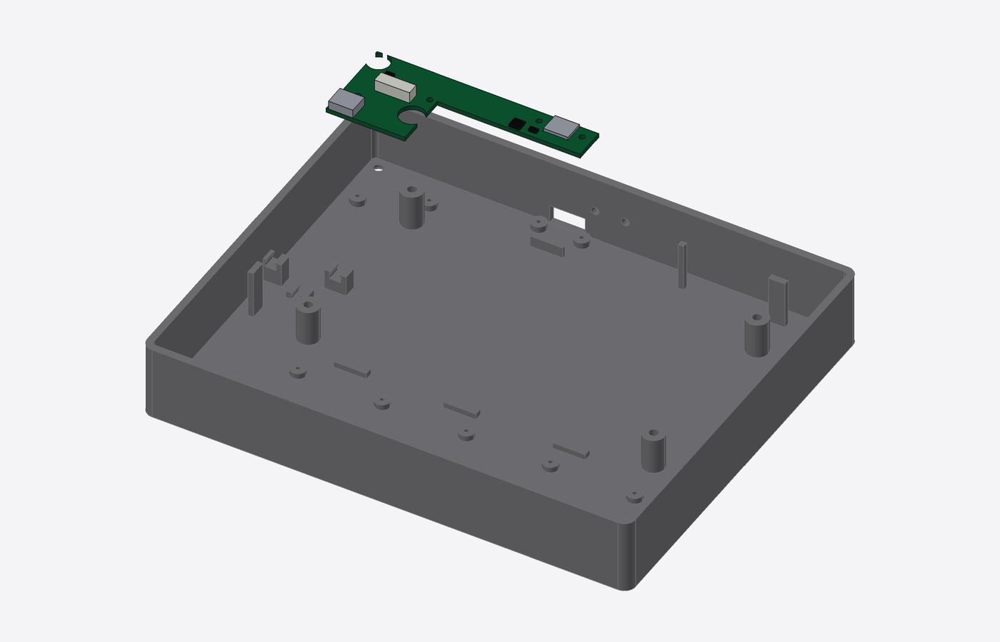

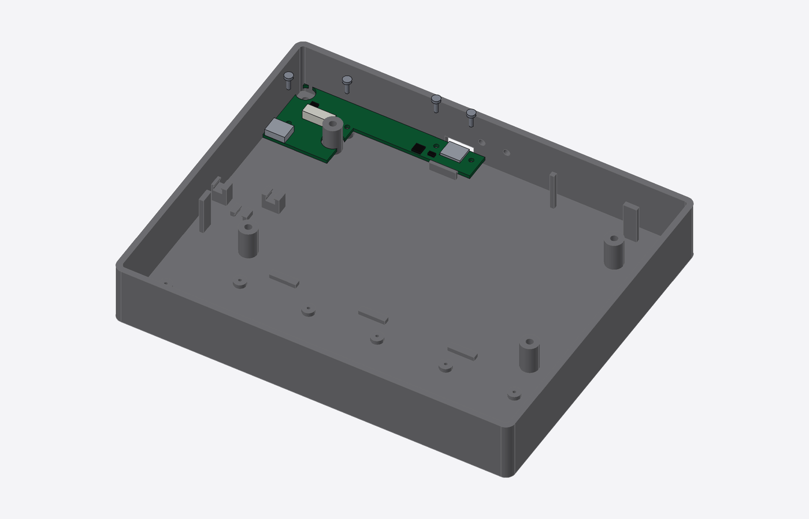

### 3. Screw in the backplane; plug in the USB link

With the PC unplugged: lower the backplane in over the ten slot bosses (they come up through its holes and locate it), with its back strip on the floor ribs, and screw it down at both ends and along the back strip (thread-forming, don't overtighten). Before the first power-up, check the JST-GH cable pin 1 to pin 1 with a meter. Plug it into the backplane's back-left corner and into the USB board (both click), and press it into its floor clip. The BOOTSEL button on the backplane's left end sits over the small hole in the floor (for recovery).

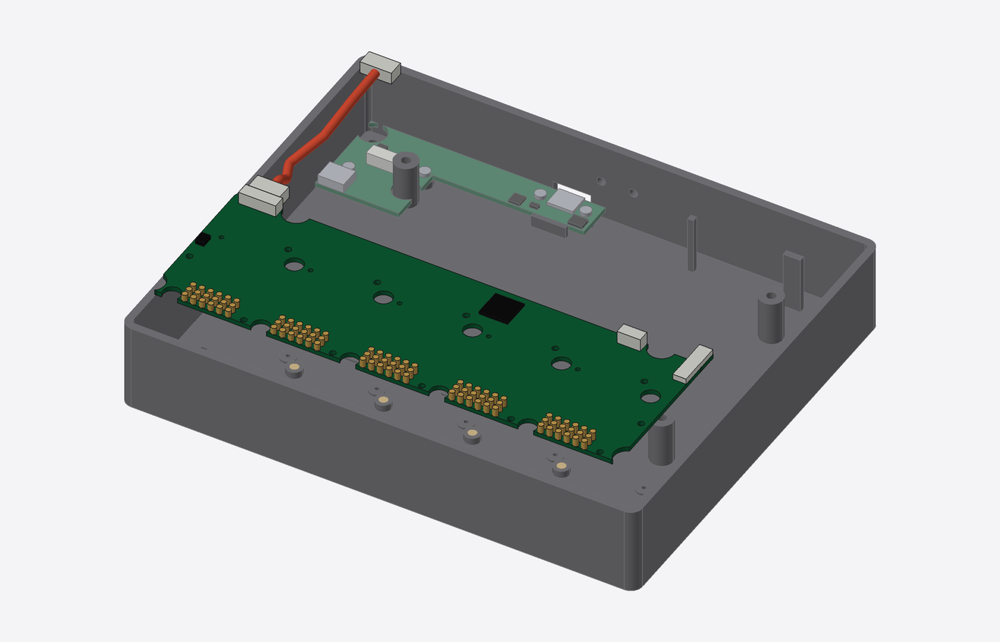

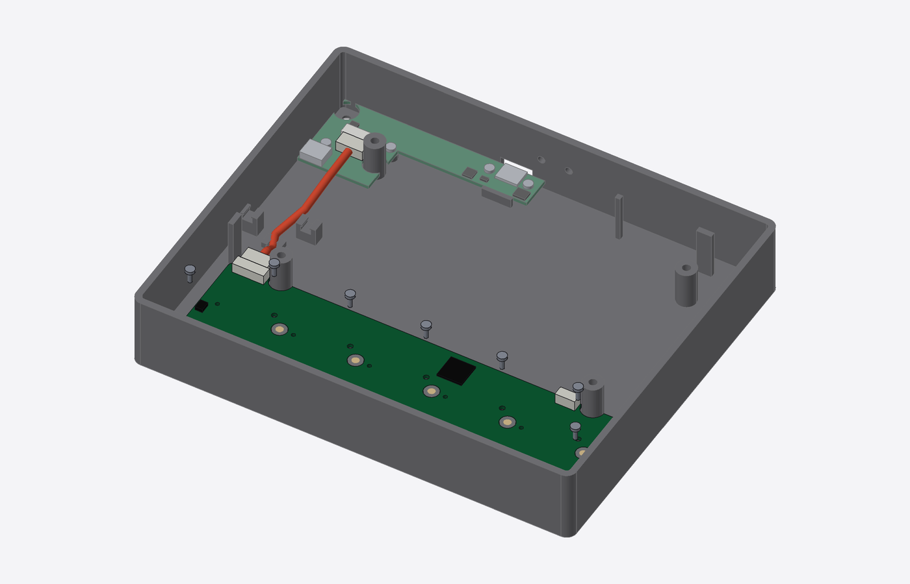

### 4. Mount the display; plug in its USB cable

Stand the tray upright on two blocks (~50 mm high) under its left and right walls, so screws can go in from below without turning it over. Lay the panel face up on its four posts, against the three printed stops behind and beside it, and drive the four M3 screws up from underneath into the panel's tabs (the tip ends ~2 mm past the tab face, short of the LCD's back sheet: don't substitute longer screws). Plug the right-angle end of the USB-C cable into the display board's USB port (the one nearer the back; the cable points forward), loop it round in the bay and plug the straight end into the USB board. Press the cable into its two floor clips, clear of the backplane. Optional GPIO6 link: before laying the panel down, plug the HY2.0 3-pin lead into the 3-pin header on the backplane's back edge, then into J8 on the display board's right edge (check the silkscreen: J8 is the GPIO6 port).

### 5. Build the top plate (on the bench)

With the top plate face up, drop the five clear knob-window covers into their pockets (they rest on a ledge) and fix each with a little clear UV glue or clear tape on the ledge. Lay the plate face down. Drop the clear caps into their holes, tabs toward the front edge; each should slide freely in its guide. Plug the key cable (FFC) into the frame PCB's ZIF connector (flip the latch up, slide the cable in, latch down), then fit the frame PCB over the plate's two locating pins (switches facing the caps) and screw it to the bosses: pan-head screws along the back and left edges (off the glass), countersunk ones everywhere else (flush underneath, so nothing touches the glass). Every key should click and none read pressed at rest: if one does, add a 0.1 mm shim washer between the nearest bosses and the PCB.

### 6. Close the case

With the PC unplugged: shake out any loose screws or debris. Rest the top plate on the two printed props (`print_plate_prop.stl`) on the tray's walls, which hold it ~40 mm up with the key cable plugged in. Plug the key cable into the backplane's ZIF connector at its right end; the spare cable folds into the gap by the right wall, outside the fence next to slot 4. Take the props out and lower the top plate (its tabs and the dividers between the slot openings register it). With the tray still on its blocks, drive the four M3 screws up from underneath into the inserts in its posts. The slots are still empty: the knob modules go in from the top, with the case closed.

### 7. Build the knob modules (on the bench)

Each slot takes a haptic module, a lite module or a blank (D23). **Haptic module:** lay the module PCB in its printed base (the pads underneath face down through the base's window). Glue a diametric magnet to the bottom end of the motor shaft. Set a printed spacer ring on the tongue (its two pins drop into the holes beside the MT6701 and center the motor, so the magnet sits within 0.3 mm of the sensor axis), put the motor on it with its lead pointing forward, and drive four M2×8 screws up from under the tongue into the motor base. Never use longer screws: a tip past the base's thread can short a winding. The spacer's arm reaches forward over the slot to above the press switch on the front border: thread an M2×3 set screw (the striker) down through the arm's tip. Screw a printed hub onto the bell with four M2×3 countersunk screws (its spigot centers it). Plug the motor's 3-pin plug onto the upright header on the front border (any way round: the firmware finds the phase order) and coil the spare lead flat in the space right of it, in front of the bell, clear of the bell. Calibrate: turn the striker until the knob clicks after a light press on the hub, then back it off a quarter turn. **Lite module:** the encoder comes soldered to the module PCB; lay the PCB in its base. **Blank:** nothing to build.

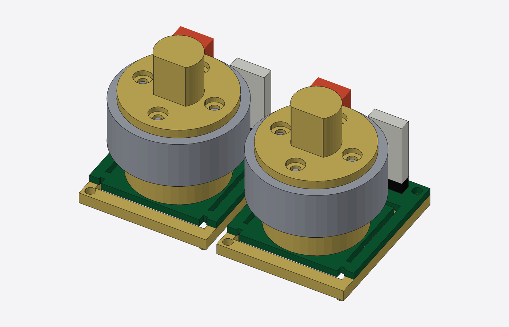

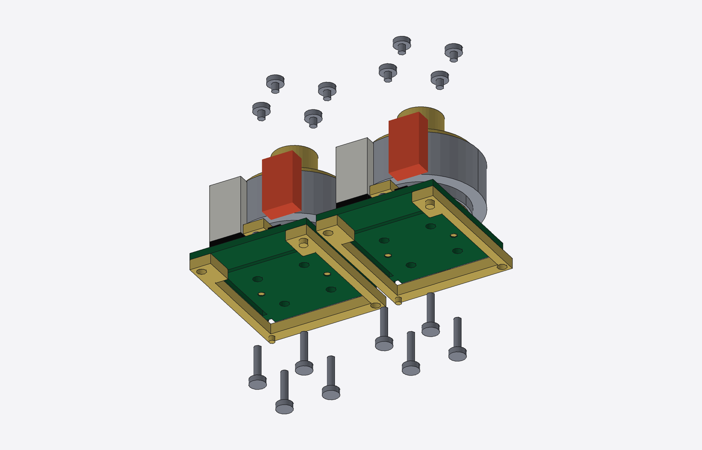

### 8. Drop in the knob modules and blanks; screw them down

With the PC unplugged (no hot-plugging): drop each module, base first, straight down through its opening in the top plate. The dividers either side guide it, and the two key pins under the base only fit the backplane's holes one way round, so a module turned back to front won't seat. Its pads land on the slot's pogo pins as it goes down. Set the printed cover on it (the bezel sits flush in the opening, around the hub) and drive the two countersunk M2 screws through the bezel's corners into the inserts in the slot bosses, until the bezel is flush with the plate. A blank is one printed part: drop it in and screw it down the same way. Swapping later is the same in reverse: pull the knob cap, undo the two screws, lift the module out by its cover.

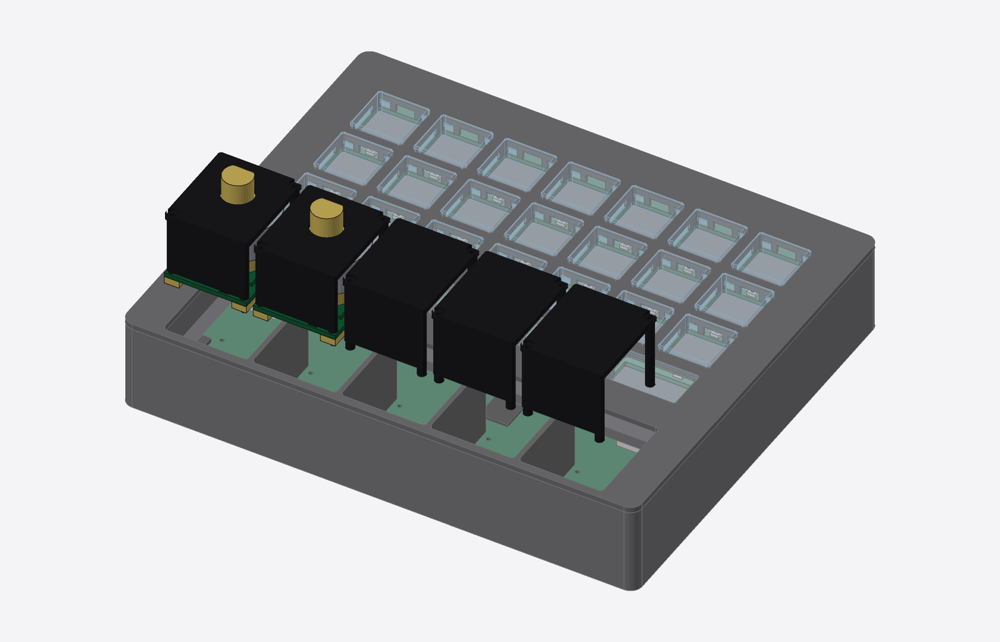

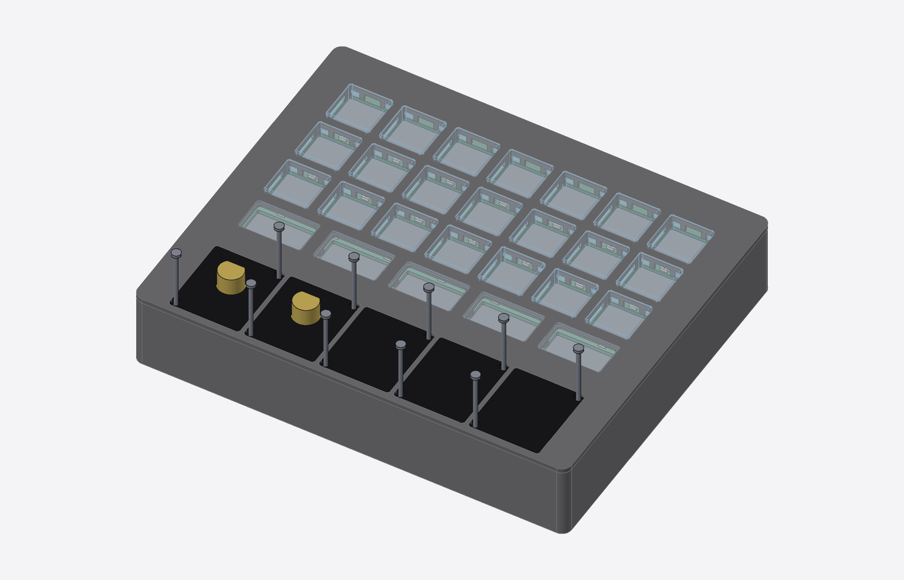

### 9. Press on the knob caps

Press each knob cap onto its hub (haptic) or encoder shaft (lite). They pull straight off for service.

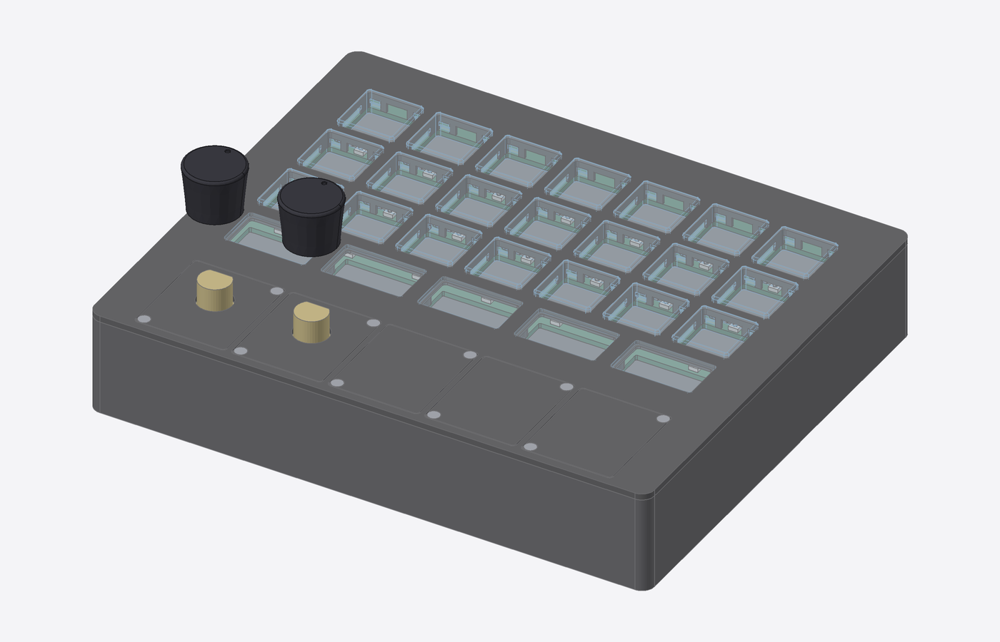

### 10. Put it on the stand

To get the polarity right, stack each stand magnet on its mating tray magnet (so they attract), mark the stand magnet's exposed face, and glue it into the stand with that marked face down (away from the tray). Stick the four feet on the stand's corner blocks. Set the slab on the stand: its front edge drops behind the stand's lip, which carries it, and the magnets locate it.

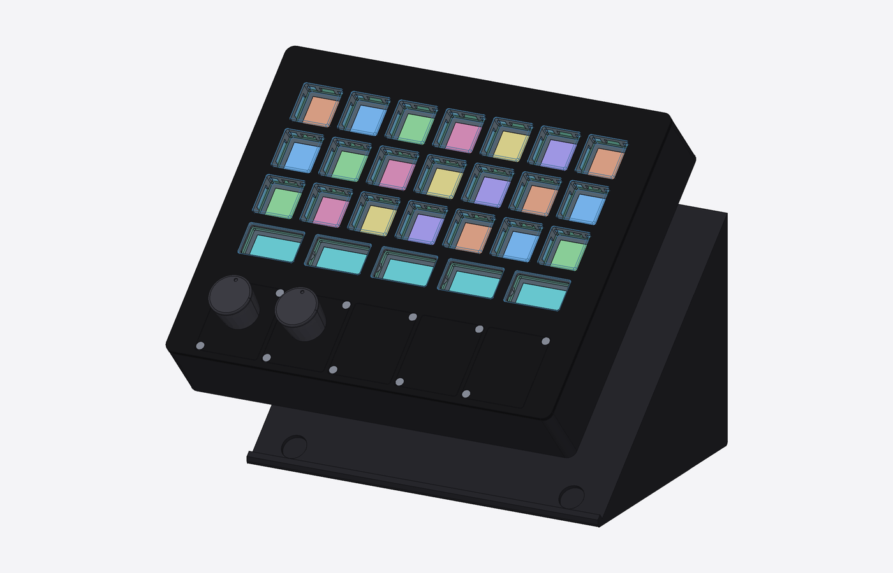

### 11. Plug it in

Plug a USB-C cable from the computer into the port in the back wall. A C-to-C cable lets the device see how much current the port offers; an A-to-C cable works too, with weaker haptics (500 mA budget). With only lite modules and blanks, any port and cable will do.

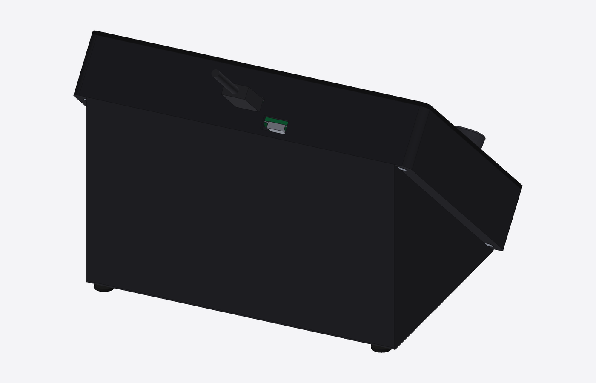

## Service

### Open the case

1. Pull the slab off the stand (magnets).
2. Pull the knob caps straight up.
3. Undo the four M3 screws under the tray (the top plate's posts).
4. Lift the top plate straight up, with the caps and frame PCB on it. The modules
   and blanks stay in their slots; the plate's openings lift over them. The key
   cable reaches 40 mm; at that height flip the ZIF latch up at the
   backplane's right end to free it.

### Swap a knob module (case closed)

No hot-plugging: unplug USB first. Pull the knob cap, undo the two countersunk M2 screws
in the cover's corners, and lift the module (or blank) straight up by its cover. Drop
the new one in the same way round (the key pins only fit one way), set its cover on, and
drive the two screws until the bezel is flush. Plug USB back in: the device reads which
module is in each slot at power-up. Checked in the model for every slot of the default
build, all-haptic and all-lite: each module lifts straight out with the plate on.

### Swap a key cap or switch

With the top plate off and face down, undo the frame PCB's 14 screws, lift the PCB
and replace the cap or switch. Keep any shim washers with their bosses.

### Recovery (factory reset)

Full steps: [recovery.md](recovery.md). Nothing needs the case opened:

1. **Always first: unplug for 10 s.** The 7B's I/O expander isn't reset by an ESP32
   reset, so a stuck USB/CAN switch (EXIO5) only clears on power-off.
2. **Settings reset** (firmware kept): hold the top-left key while plugging in.
3. **Factory firmware:** the web configurator's "Restore factory firmware" flashes the
   pinned release builds to both chips through their ROM bootloaders.
4. **If a chip doesn't answer,** start its bootloader by hand with a paperclip: BOOT (and
   RESET) for the display board through the two holes in the back wall; BOOTSEL for the
   backplane through the hole in the floor under its left end (pull the slab off the
   stand first). Hold the button while plugging in. Checked in the model: a straight
   1 mm clip reaches each button and touches nothing else.
5. **Never burn ESP32 eFuses or RP2350 OTP** (secure boot, flash encryption, disabling
   download mode or BOOTSEL). That is the only brick a pinhole can't undo.

Don't fit a battery to the 7B's J3, and unplug the back cable before using the
7B's UART port: either one would feed 5 V back into the hub and the PC.

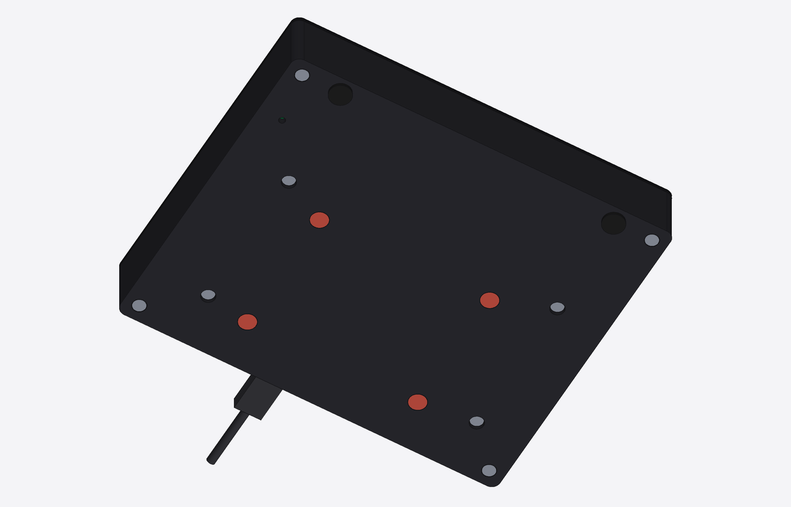

### Replace a motor

Lift its module out (above), take the cover off and unplug the motor from the upright
header on the module's front border. Undo the four screws under the tongue.

### Replace the backplane

Take every module and blank out, then open the case (PC unplugged). Unplug the USB-C
cable at the display board, remove the display (four M3 screws from underneath), unplug
the JST-GH cable at the backplane (press the latch), undo the backplane's screws at both
ends and along its back strip, and lift it off the slot bosses. Its back strip sits
under the display, which is why the display comes out first.

