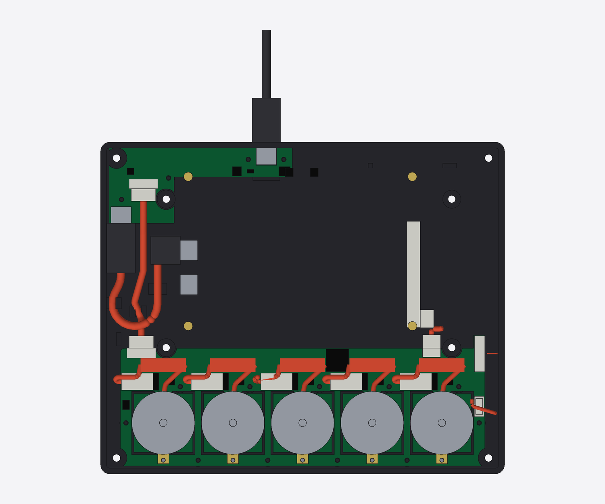

# Wiring and power

How the boards connect, where power comes from, and how the cables are held.
The builder solders and crimps nothing: JLC fits every board-mounted
connector, and every cable is bought ready-made and plugged in. Pinouts of
Waveshare's board are from its schematic
([ESP32-S3-Touch-LCD-7B-Schematic.pdf](https://files.waveshare.com/wiki/ESP32-S3-Touch-LCD-7B/ESP32-S3-Touch-LCD-7B-Schematic.pdf),
read 2026-10-17) and its STEP model. Untested, like everything else in this
repo.

## Overview

```
 PC ──USB-C (back wall)──► USB board: CH334F USB 2.0 hub, reads the port's current offer
                            ├─ hub port 1 ── JST-GH 8-pin cable ──► knob board: RP2350B native USB
                            │                (USB D+/D−, 5 V ×2, GND ×2, CC sense ×2)
                            └─ hub port 2 ── USB-C socket ── 100 mm USB-C cable ──► Waveshare 7B native USB
                                                                       (5 V for the display board too)

 knob board (RP2350B) ◄── 12-pin FFC ── frame PCB (21 key switches + diodes)
        ├──── JST-SH 6-pin cable ────► touch band (touch controller, I²C)
        ├──── 3-pin plug ×5 ─────────► 2204 motors
        └┄┄┄┄ HY2.0 3-pin lead (optional) ┄┄► Waveshare 7B J8 (GPIO6): page, wake
```

The PC sees two USB devices behind a hub: the display board (ESP32-S3:
images, display settings) and the knob board (RP2350B: keys, knobs, touch,
haptics). The web configurator and the optional daemon pair them
([protocol.md](protocol.md)). Each chip updates over its own USB
connection. The only link between the chips inside the case is the
optional one-wire lead (see "Link to the display board").



## Where things go (and why)

**USB board in the back-left corner.** The knob board runs across the front
and the display board fills the middle, so the free space is a 34 × 75 mm bay
beside the display board's left edge (under the panel, 10 mm tall) and an
8.5 mm strip behind it. The USB board's main part sits in the bay; a narrow
arm runs along the back wall to the external socket. Options considered:

| | Option | Verdict |
|---|---|---|
| a | **Small USB board at the back** (external USB-C, hub, current sensing), cabled to the display board and the knob board | **Chosen.** The external socket is ours, so it can be clamped to the wall and its CC pins read directly. It sits next to the display board's USB port, so that cable is the shortest stock length (100 mm). One more board in the same JLC panel |
| b | Hub on the knob board, panel-mount USB-C extension from the back wall | Two USB-C cables crossing the case, and the extension's own socket and wiring are a third-party part: cheap ones often don't carry the CC wire through, which would lose current sensing (and C-to-C cables might not get 5 V at all). Extensions aren't allowed by the USB-C spec |
| c | Hub on the knob board, a plain "port board" at the back | Still needs a 2 A cable plus the CC lines from the back to the front, the same harness as (a), and a longer display cable |
| c' | USB board standing upright against the back wall | 8.5 mm behind the display board isn't enough for the board plus plugs going into it |

**External port 16 mm left of center**, not dead center: the center of the
back wall has the two pinholes for the display board's BOOT and RESET
buttons. The opening is 3 mm from the nearest pinhole, and a plugged-in cable
still leaves the pinholes free (checked in the model). A third pinhole, in
the case floor under the knob board's left end (11 mm from the left edge,
30.5 mm from the front), reaches the knob board's BOOTSEL button, so both
chips can be put into their bootloaders from outside; lift the slab off
the stand to use it ([recovery.md](recovery.md); pictures in
[assembly.md](assembly.md)).

**Display board cable.** Waveshare's board has two USB-C ports on its left
edge (facing left, about 26 mm in from the panel frame's left edge, from the
STEP model): the native USB port, 36 mm from the board's back edge, and the
USB-to-UART port 15 mm in front of it. The schematic confirms Type_C2
("USB") is native (Type_C2 → R65/R66 → U9 → GPIO19/20); its position comes
from Waveshare's PCB view: **check the silkscreen on the real board.** The
port's center is only 12.8 mm above the case bottom and 9.0 mm below the
glass (the board sits 2.7 mm above the floor, with no floor pocket), so the cable's
display end is a **90° side-exit plug** (cable leaves sideways in the plane
of the plug's wide face, here toward the front). USB-C is reversible, so a
"left-angle" plug flipped over is a "right-angle" one; "up/down-angle" plugs
don't fit. The cable loops forward through the bay (bend radius 10 mm) and
comes back into the USB board's socket with a straight plug. The model sizes
the loop for a 100 mm cable; 95–110 mm cables fit (the loop takes up the
difference).

**Keys and touch at the right end of the knob board.** The left end is taken
by the USB link and the loop, so the key FFC runs from a ZIF connector on top
of the frame PCB's right edge, down the 1 mm gap between the panel and the
right wall, into a ZIF connector on the knob board's right end. The touch
band's connector sits at its right end, just past the last motor; its cable
drops to a top-entry header beside the ZIF.

**Motor plugs behind each tongue**, pointing left, with the spare lead
coiled flat on the back strip and strapped through two slots. See
"Motors" below.

## Display board facts (from the schematic and STEP model)

- **Native USB-C ("USB", Type_C2):** VBUS goes straight to the board's 5 V
  rail. The CC pins have fixed 5.1 kΩ pull-downs, so the display board
  itself can't tell how much current is offered. It doesn't need to: the USB
  board does.
- **Back-feed:** the same 5V net is also fed from the UART port (Type_C1,
  through the Q10 ideal diode) and from a battery on J3 (through a boost
  converter). Anything that powers the 5V net shows up on the native port's
  VBUS and goes back into our USB board. The USB board blocks it (see
  "Power"), but still: **never fit a battery to J3, and unplug the back
  cable before using the UART port.**
- **USB/CAN mux:** GPIO19/20 reach Type_C2 through an FSUSB42 mux (U9),
  selected by expander pin EXIO5 with a 10 kΩ pull-down (low = USB). The
  display firmware must **never drive EXIO5 high**, or USB disappears. An
  ESP32 reset doesn't reset the CH32V003 expander, so recovery from that is
  "unplug for 10 s, hold BOOT, plug in" ([recovery.md](recovery.md)).
- **Port position:** center 1.22 mm below the board's underside, face flush
  with the board's left edge (STEP; an earlier figure of 2.97 mm was wrong).
- **J8 GPIO6 (HY2.0 3-pin: 3V3, GND, GPIO6):** the optional link from the
  knob board (see "Link to the display board").
- **H3 UART2, J9 POWER, H1 I2C (HY2.0):** not used. The UART1/UART2 slide
  switch position doesn't matter.
- **I/O expander:** a CH32V003 with a PWM output for the backlight, so
  brightness is adjustable. Which dimming resistors are fitted is unknown
  until a real board is probed.
- **Board power:** 350 mA at 5 V (Waveshare's figure; unmeasured).

## Power

### Path

```
 PC VBUS ─► USB board ─┬─ TVS (clamps < 6 V) + 22–47 µF polymer ─ CH334F (its own 3.3 V regulator, 22 µF on VDD33)
                       ├─ current-limited, reverse-blocking switch (~1 A) ─► display board port VBUS (always on)
                       └─ current-limited, reverse-blocking switch (~1.8 A) ─► JST-GH pins 2+7 ─► knob board:
                              ├─ 3.3 V regulator (logic, direct)
                              └─ soft-start load switch ─► motors (enabled by firmware after reading CC)
```

- **Display board port:** a downstream USB-C socket with 56 kΩ pull-ups on
  CC1/CC2 (default USB power, per spec) and VBUS through a current-limited
  switch with **true reverse-current blocking** (part TBD from JLC stock).
  The SY6280 first picked here only blocks reverse current while disabled,
  and this switch is always on, so the 7B's 5 V rail could drive the PC's
  VBUS (see "Back-feed" above); use a part that blocks while enabled, or add
  an ideal diode after it. Set the current limit with an explicit Rset (the
  SY6280 is 6800/Rset, ±25%), and delay its enable with an RC so the 7B's
  ≥ 120 µF doesn't charge at the same moment as the knob board. A short in
  that cable can't take down the rest.
- **Knob board branch:** its own current-limited, reverse-blocking switch on
  the USB board (current limit ~1.8 A, blocking reverse current while
  enabled; at the very least a 1.5–2 A PTC), so a pinched GH cable or a shorted bulk cap can't go straight to
  the PC port.
- **Input protection:** the VBUS TVS needs a 5–5.5 V standoff and a clamp
  voltage below 6 V at the expected surge (the switches' absolute maximum is
  6 V; an ordinary 5 V TVS clamps near 9 V and doesn't qualify). Name the
  part in the BOM. Add 22–47 µF of polymer (or electrolytic) at the input to
  damp hot-plug ringing.
- **Knob board input:** logic (3.3 V regulator, sensors, RP2350B) runs
  straight from the input. The soft-start load switch (controlled rise
  time, part TBD from JLC stock) feeds only the motor rail, and firmware
  enables it after reading the CC offer, so charging the ~470 µF bulk
  doesn't sag the PC's port. 2 × 22 µF at each driver for motor current
  spikes.
- **Hub supply:** the CH334 datasheet warns of low-voltage resets under
  dynamic load. Put 22 µF on its VDD33 (or feed it from its own LDO behind a
  diode), so motor dips don't reset the hub.
- **Voltage monitoring:** the RP2350B measures its 5 V input through a
  divider on an ADC pin.

### Reading the PC's current offer

The USB board's upstream socket has the standard 5.1 kΩ pull-downs on CC1
and CC2. Both CC lines also go through 10 kΩ resistors to the JST-GH cable
(pins 3 and 6), then through another 10–22 kΩ at the knob board, on to two
RP2350B ADC pins, with 100 nF to ground at the knob board (a slow filter;
the ADC reads DC). The knob-end resistors protect the ADC pins if 5 V ever
lands on a CC pin. Firmware disables the digital input buffers on those
pins (RP2350 erratum E9). An ESD array on the USB board covers CC1/CC2 as
well as D±. Whichever CC line the cable
connects sits at (USB Type-C spec, voltage across the 5.1 kΩ):

| PC advertises | CC voltage | Motor budget (default) |
|---|---|---|
| Default USB power (or an A-to-C cable) | 0.25–0.61 V | Haptics nearly off: faint detents and ticks only |
| 1.5 A | 0.70–1.16 V | ~0.8 A (until real current is measured) |
| 3.0 A | 1.31–2.04 V | 1.5 A |

- **Policy (design review D9): full haptics need a C-to-C cable from a
  port offering 1.5 A or more.** The rest of the device already uses about
  0.5 A: display board 350 mA, hub ~50 mA, knob board logic ~120 mA (each
  MT6701 draws 10–14 mA). So on a default 500 mA port (or any A-to-C
  cable) there's next to nothing left for motors, and the configurator
  tells the user why the knobs feel weak.
- **Start-up:** the motor rail stays off and the backlight starts low until
  the knob board has read CC and been configured over USB. Firmware polls
  CC all the time, so a cable change takes effect at once.
- **Optional PD sink:** a footprint on the USB board for a CH224-class
  USB-PD sink, not fitted by default, so a PD charger can be asked for 5 V
  at 3 A when its CC advertisement says less.
- **Cap from the cable:** the JST-GH link carries 5 V on two contacts rated
  1 A each (JST's rating at 26 AWG; buy a 26 AWG cable, since cheap ones are
  28–30 AWG), so the knob board takes at most ~1.8 A whatever the PC offers
  (motor budget ≤ 1.5 A). The knob branch's switch on the USB board enforces
  this in hardware.
- **Brownout guard:** a legal 3 A port can deliver only 4.2–4.4 V at the
  knob board (4.75 V at the source minus cable, contact and switch drops),
  so a fixed 4.6 V threshold would trip on good ports. Instead, trip when
  the 5 V input falls more than ~300 mV below its idle value, with an
  absolute floor near 4.2–4.3 V, using a fast comparator. On a trip the
  firmware cuts motor current right away and lowers the budget; it recovers
  with hysteresis, and every trip is logged in `STATUS`.
- **User setting:** can lower the budget, or raise it for a port known to
  supply more than it advertises (within the cable cap).
- The arbiter from [plan.md](plan.md) (wake on movement, one active knob
  gets the budget, two split it) works inside this budget.

## Connectors

All on the boards, fitted by JLC. Part numbers: [bom.md](bom.md).

| Board | Connector | Mates with | Notes |
|---|---|---|---|
| USB board | USB-C, mid-mount (sinks into the board), through-hole shell legs (unverified: LCSC lists C2894902 as SMD-only) | PC cable | External; see "Strain" |
| USB board | USB-C, top mount, 4 through-hole shell legs (TYPE-C-31-M-12) | Display cable, straight end | Faces forward |
| USB board | JST-GH 8-pin, side entry (SM08B-GHS-TB) | USB link cable | Faces forward; positive latch |
| Knob board | JST-GH 8-pin, side entry | USB link cable | Back-left corner, faces back |
| Knob board | 1×3 2.54 mm right-angle header ×5, SMD (part not chosen; THT fallback) | Motor plugs | Behind each tongue, pins point left. Shrouded or keyed if the motor plug has a key |
| Knob board | 12-pin 1.0 mm flip-lock ZIF | Key FFC | Right end, on a small tab. Series resistors and a TVS array on the key lines |
| Knob board | JST-SH 6-pin, top entry (BM06B-SRSS-TB) | Touch cable | Right end, front. TVS array on the lines |
| Knob board | HY2.0 3-pin, footprint always, fitting optional | Link lead to the 7B's J8 | GPIO6 link (see below) |
| Knob board | BOOTSEL button: reverse-mount tact switch (part not chosen), plunger through the board, reached through a pinhole in the case floor | — | Recovery ([recovery.md](recovery.md)) |
| Knob board | USB test pads | — | Bench recovery only. Silkscreen "unplug GH first" (the pads would back-feed with the cable in) |
| Frame PCB | 12-pin 1.0 mm flip-lock ZIF, top side | Key FFC | Right edge; the frame PCB's edge is about 1.2 mm inside the panel's metal edge (model) |
| Touch band | JST-SH 6-pin, side entry (SM06B-SRSS-TB), underside | Touch cable | Right end, past the last motor |

### Pinouts

**USB link, JST-GH 8-pin** (cable wired pin 1 to pin 1):
`1 GND · 2 VBUS · 3 CC1 sense · 4 D− · 5 D+ · 6 CC2 sense · 7 VBUS · 8 GND`.
The order is mirror-symmetric: a reversed cable (sold next to straight
ones) only swaps D+/D− (no enumeration, no damage) and CC1/CC2. GND on the
outer pins keeps VBUS off the edge pins, which touch first when a plug goes
in at an angle. GH contacts aren't staggered, so unplug the PC before
plugging or unplugging this cable. Check pin-1-to-pin-1 continuity on a new
cable before first power-up. USB full speed (12 Mbit/s) over ~100 mm of
unshielded wire is fine; JST-GH carrying USB is the drone-controller
(Pixhawk) convention. Route D+/D− as a pair on both boards.

**Upstream is high speed.** The CH334F talks 480 Mbit/s to the PC; only the
two downstream legs are full speed. See "USB board connections" for the
routing rule.

**Keys, 12-pin FFC:** `1 GND · 2–8 columns 1–7 · 9–11 rows 1–3 · 12 GND`.

**Touch, JST-SH 6-pin:** `1 GND · 2 3V3 · 3 SDA · 4 SCL · 5 3V3 · 6 GND`.
Mirror-symmetric, so a reversed cable only swaps SDA and SCL and can't
reverse-power the touch chip. There's no interrupt line: firmware polls the
controller. I²C pull-ups sit on the knob board; the band has a ferrite bead
plus 10 µF on its 3V3.

**Link to the display board, HY2.0 3-pin** (matches the 7B's J8:
`3V3 · GND · GPIO6`): only GND and the signal connect on the knob board.
Its 3V3 pin is left open, so the two boards' 3.3 V rails never meet. A
spare RP2350B pin sends a one-way UART to the ESP32-S3's GPIO6 through a
1 kΩ series resistor: page switches, activity (wake), the 3 s knob-hold
confirmation and settings reset ([protocol.md](protocol.md)). The knob
board always has the footprint; fitting the connector and buying the lead
is optional. Without it, the device still works standalone, but pages
don't change images and the display never idle-blanks without a host.

**Motors, 1×3 header:** phases U, V, W. The plug goes on either way round,
which changes the phase order. Calibration finds the order once; at the
first wake after power-up the firmware runs a small open-loop direction check and throws
away the stored calibration if it no longer matches.

### Cables

Bought ready-made; lengths from the model (`cad/assembly.py`, table in
[assembly.md](assembly.md)):

| Cable | Buy | Why that length |
|---|---|---|
| USB-C to USB-C, USB 2.0, one 90° side-exit plug + one straight plug | 100 mm | Loop sized for it (route 98 mm) |
| JST-GH 1.25 mm 8-pin, both ends, pin 1 to pin 1, 26 AWG | 100 mm | Route 73 mm, the rest as a gentle S. Check pin-1-to-pin-1 continuity on arrival |
| FFC 12-pin 1.0 mm, contacts on opposite sides (type B) | 80 mm | Top plate lifts 40 mm with it plugged in (needs 70 mm) |
| JST-SH 1.0 mm 6-pin, both ends, pin 1 to pin 1 | 80 mm | Same (needs 69 mm). A longer spare folds against knob 4's bell |
| HY2.0 3-pin, both ends (optional link) | 50 mm | Knob board to the 7B's J8 (route 27 mm) |

**FFC contact side:** with top-contact ZIF connectors on the top of both
boards as modeled, the cable's contacts end up on opposite sides (type B).
If the ZIF picked has bottom contacts on one board, it flips to type A:
check before ordering.

## Strain and service

**External socket.** Plugging in, yanking or levering the PC cable must not
load solder joints:
- The socket is a **mid-mount** part with **through-hole shell legs**
  (unverified: LCSC lists C2894902 as SMD-only, so get its drawing; if it
  has no real THT legs, pick a mid-mount part that does), and its face sits flush with the inside of the back wall. The plug's overmold
  seats 2.5 mm deep into a 13 × 7 mm opening in the wall, so a sideways pull
  levers the plug against the case, not the socket. (Most cables'
  overmolds are 10.5–12.5 × 5.5–6.5 mm and seat fully; a bigger one stops
  at the wall.)
- **Push-in:** the USB board's arm rests against a printed backstop rib on
  the floor right behind the socket.
- **Pull-out:** the board's edge sits against the back wall.
- **Screws:** two M2×6 screws either side of the socket, two more in the
  main part of the board, into printed bosses.

**Internal USB-C.** The USB board's socket has four through-hole shell legs.
The cable is pressed into two printed clips on the tray floor, so tugging the
loop doesn't pull on either socket. Bends stay at 10 mm radius or more, and
the loop stays off the knob board and away from the motors (checked).

**Latches.** JST-GH and the ZIF connectors latch. JST-SH holds by friction
only; it's the short touch cable, which nothing pulls on once the case is
closed.

**Clips and ties.** Three push-in clips printed with the tray (two for the
display cable, one for the USB link). Motor leads: hook-and-loop ties
through slots in the knob board.

**Motors.** The 2204 lead (~30 cm with a 3-pin servo-style plug per one
listing; **verify on arrival**) leaves the motor base under the bell, runs
back over the hinge to the back strip, and plugs into the header behind its
tongue. The rest coils flat on the back strip (a 20 mm long coil, 3
layers) under the panel and is strapped through two slots, clear of the
spinning bell. A 30 cm lead makes a 6.6 mm high coil in the 11.1 mm under
the panel. Measure the real lead's length and diameter on arrival.

**Service loops.** The top plate lifts 40 mm with the key and touch cables
still plugged in (checked), which is enough to reach the ZIF latch and the
touch plug at the knob board's right end. The display board's USB cable and
the USB link unplug before the display or the knob board come out (guide in
[assembly.md](assembly.md)).

**Plug insertion.** Every plug has a straight path into its socket at the
step that connects it (checked in the model, like the screwdriver access).

## Key matrix

- **7 columns × 4 rows = 28 positions:** rows 1–3 are the 21 keys on the
  frame PCB; row 4 is the 5 knob press switches on the knob board (sharing
  the column lines).
- **One diode per switch** (SOD-123, e.g. 1N4148W) so any combination of
  keys can be held at once (needed for held modifiers and push-to-talk):
  26 diodes, 21 on the frame PCB and 5 on the knob board.
- **ESD:** the cap gaps leave ~5.6 mm air paths to the B3U terminals, and
  the lines run 80 mm of FFC to bare GPIO. The frame PCB has a GND guard
  ring around each window; the knob board has series resistors and a TVS
  array at the ZIF.

## RP2350B pin budget (48 GPIO)

| Use | Pins |
|---|---|
| Motor PWM, 3 per motor × 5 | 15 |
| Motor driver standby (TMC6300 VIO), one per motor so each sleeps independently | 5 |
| MT6701 sensors: shared chip select + clock, 5 separate data lines (read together by PIO) | 7 |
| Key matrix, 7 columns + 4 rows (includes knob presses) | 11 |
| I²C to touch band (polled, no interrupt) | 2 |
| 5 V monitor (ADC) | 1 |
| CC1/CC2 current-offer sense (ADC) | 2 |
| Link to the display board (UART TX, optional lead) | 1 |
| **Total** | **44 of 48** |

USB, RUN and the SWD debug pins are separate pins on the RP2350B and don't
count against the 48.
Constraints for the schematic: each motor's 3 PWM signals should share one
PWM frequency; GPIO n and n+16 share a PWM channel, so map the 15 PWM
signals to 15 distinct channels in the schematic; the three analog inputs
need GPIO40–47. 10 kΩ pull-downs on every `NSTDBY` and PWM net (RP2350
erratum E9; see [knob-module.md](knob-module.md)).

## Frame PCB connections

- 21 B3U switches + 21 diodes, 7 columns × 3 rows.
- GND guard ring around each key window.
- One 12-pin flip-lock ZIF connector (1.0 mm pitch) on the top side at the
  right edge.
- Nothing else: no chips.

## Touch band connections

- Touch controller **AT42QT2120** (SOIC-20, LCSC C614938) + 12 electrodes,
  1–10 kΩ in series with each electrode next to the chip. All 12 channels
  run as keys; firmware interpolates the position (the chip's own slider
  uses only 3 channels, too coarse for the band).
- JST-SH 6-pin, side entry, on the underside at the right end.

## USB board connections

- CH334F hub (QFN-24), USB ESD protection (an array covering D± and CC),
  TVS (see "Input protection").
- **Crystal:** a 12 MHz crystal on XI/XO (load caps are built in), fitted,
  plus a 0 Ω link that can ground XI for crystal-free mode. The CH334
  datasheet says crystal-free mode isn't on by default on some package
  forms, and JLC can't confirm it at ordering.
- **Power strap:** PSELF strapped low (bus-powered), with a 0 Ω option to
  flip it. Both firmwares declare bMaxPower ≤ 100 mA, since Linux gives each
  port of a bus-powered hub only 100 mA and refuses configurations above
  it.
- **Placement:** the hub sits next to the external socket, so the
  480 Mbit/s upstream pair is under 15 mm: a 90 Ω coplanar pair with no
  vias, over unbroken ground, with the USBLC6 in line at the socket. The
  long runs are the full-speed downstream legs.
- Confirm in the CH334F's datasheet row: MTT (one translator per port) and
  integrated terminations.
- Upstream: external USB-C (CC1/CC2 5.1 kΩ to GND, sensed through 10 kΩ).
  Shell to GND at the socket.
- Optional USB-PD sink (CH224-class) footprint on the upstream CC lines,
  not fitted by default (power policy above).
- Downstream port 1: JST-GH 8-pin to the knob board (VBUS through its own
  ~1.8 A reverse-blocking switch). Port 2: USB-C to the display board (56 kΩ
  CC pull-ups, VBUS through a ~1 A reverse-blocking switch). Ports 3–4
  unused (test pads).
