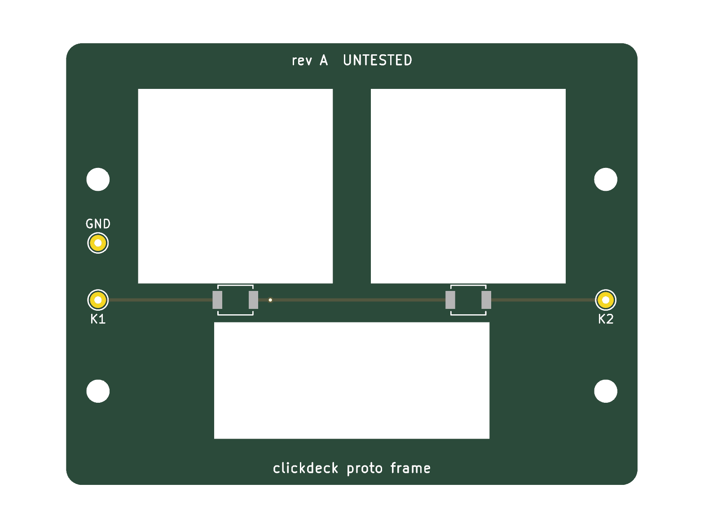
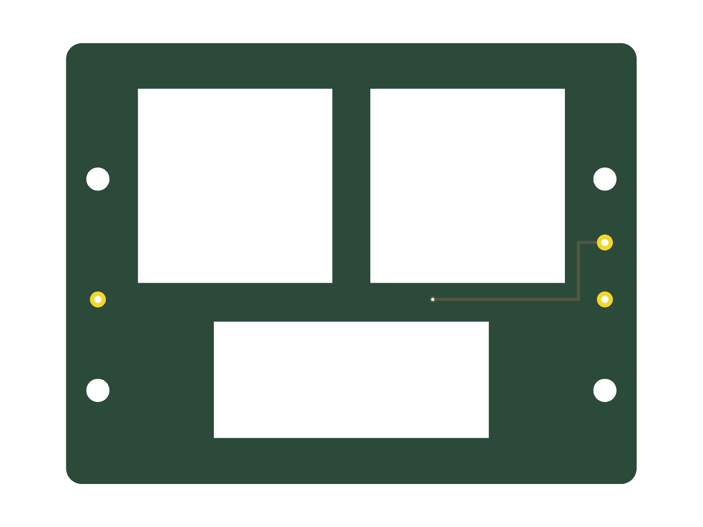

# Hardware (PCBs)

> **Untested.** These boards were generated by an AI assistant and have
> never been manufactured. Passing DRC only means the copper doesn't break
> KiCad's rules; it says nothing about whether the board works or fits.
> Check JLC's preview (especially switch rotation) before ordering.

Boards are **generated from the CAD model** so they can't drift out of
alignment with the case: `cad/build.py` writes each board's geometry
(outline, windows, switch and hole positions) to `cad/out/*.json`, and a
script here builds the KiCad board from it.

Tools: KiCad 9 (`kicad-cli`, and the `pcbnew` Python module for the system
Python), plus the project's `.venv` for the CAD.

## Boards

| Board | Status | Folder |
|---|---|---|
| Prototype frame PCB (2 keys) | Generated, DRC clean, untested | [`proto-frame/`](proto-frame/) |
| Rev 0 knob module | Schematic next; layout waits on measuring the motor | — |
| Full frame PCB (21 keys) | After the prototype | — |
| Full knob board | After the prototype | — |
| Touch band | After the prototype | — |

## Prototype frame PCB

Two B3U switches on the strip below the key windows, three through-hole
wire pads (K1, K2, GND) to hand-wire to the ESP32-S3 dev board, and four M2
holes. It hangs from the acrylic top plate on 3 mm M2 standoffs, resting
0.2 mm above the display glass.

```sh
hardware/proto-frame/export.sh     # CAD -> KiCad -> DRC -> JLC files
```

Outputs in `proto-frame/jlc/`: Gerbers + drill (`proto-frame-gerbers.zip`),
`proto-frame-bom.csv` and `proto-frame-cpl.csv` for JLC assembly of the two
switches (LCSC C231329). The board is defined in `gen_pcb.py` (no separate
schematic for a 2-switch board).

| Top | Bottom |
|---|---|
|  |  |
