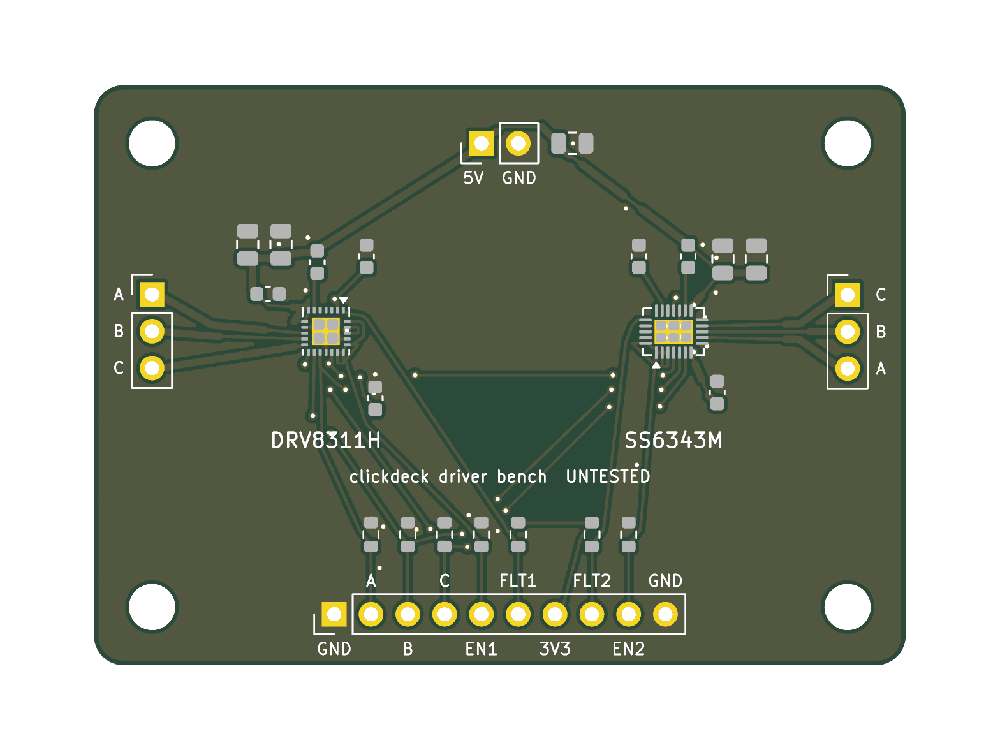
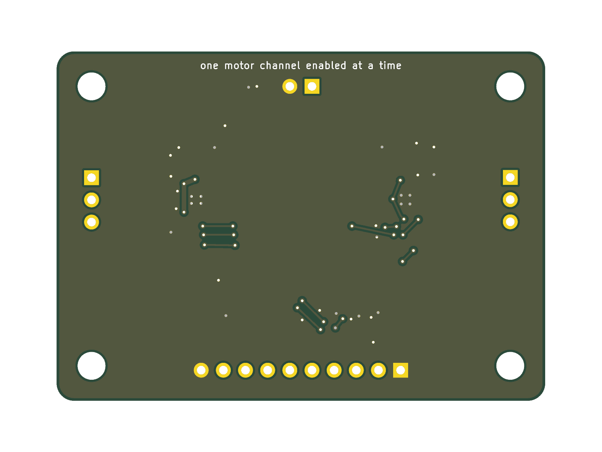

# Hardware (PCBs)

> **Untested.** These boards were generated by an AI assistant and have
> never been manufactured. Passing DRC only means the copper doesn't break
> KiCad's rules; it says nothing about whether the board works or fits.
> Check JLC's preview (especially switch rotation) before ordering.

Boards are **generated from the CAD model** so they can't drift out of
alignment with the case: `cad/build.py` writes each board's geometry
(outline, windows, switch and hole positions) to `cad/out/*.json`, and a
script here builds the KiCad board from it.

Tools: KiCad 9 (`kicad-cli`, and the `pcbnew` Python module for the system
Python), plus the project's `.venv` for the CAD.

## Boards

| Board | Status | Folder |
|---|---|---|
| Prototype frame PCB, rev C (2 keys on the 7B) | Generated, DRC clean, untested | [`proto-frame/`](proto-frame/) |
| Driver bench board (D24: DRV8311H + SS6343M channels, test kit) | Generated, DRC clean, untested | [`driver-bench/`](driver-bench/) |
| Rev A frame PCB (21 keys) | After the prototype. Outline: `cad/out/full_frame_pcb_outline.dxf` | — |
| Rev A backplane (D23: RP2350B, connectors, a pogo-pin slot connector per knob slot) | After the prototype ([pcb.md](../docs/pcb.md), [wiring.md](../docs/wiring.md)). Outline: `cad/out/full_backplane_outline.dxf` | — |
| Rev A haptic module (one knob: DRV8311H, MT6701, press switch, motor header) | After the prototype; first build of the knob circuit ([knob-module.md](../docs/knob-module.md)). Outline: `cad/out/module_haptic_pcb_outline.dxf` | — |
| Rev A lite module (D22: push encoder) | With the haptic module; same outline and pads ([knob-module.md](../docs/knob-module.md), end). Outline: `cad/out/module_lite_pcb_outline.dxf` | — |
| Rev A USB board (CH334F hub) | After the prototype. Outline: `cad/out/full_usb_board_outline.dxf` | — |
| Touch band (optional add-on, off by default, D24) | When a build fits it (D12). Outline: `cad/out/full_touch_band_outline.dxf` | — |

Dropped 2026-10-18 (D3): the Rev 0 knob module and the Rev 0.5 test
board. The prototype uses bought breakouts for the knob, controller and
hub ([parts.md](../docs/parts.md)), so rev C and the driver bench board
(D24) are the only custom boards before Rev A. Plan on one revision of whichever Rev A board fails, ordered
alone ([cost.md](../docs/cost.md)).

## Prototype frame PCB (rev C)

The prototype now sits on the real Waveshare 7B (design review D3), so this
board is the full build's frame cut down to its **two top-left keys**, at
the same place on the panel. Its left and back edges reach past the glass,
like the full frame's.

- **Switches:** SW1/SW2 under the key windows (the full build's position)
  and **SW3/SW4 above them: the second-switch option** for the D8 force test
  (one switch vs two per key). Each has its own wire pad. Use the one-nub
  caps (`key_cap_clear_resin.stl`) for the one-switch test and the two-nub
  caps (`key_cap_two_nub_clear_resin.stl`) for two switches.
- **Wire pads** K1, GND, K1B, K2B, K2 (through-hole) on the back margin, off
  the glass, for hand-wiring to the RP2350B core board.
- **Mounting:** M2 pan-head screws only where the head is off the glass (two
  on the left edge, two on the back edge). Over the glass the board uses
  **countersunk holes** (JLC's countersink option, 90°; extra fee), so the
  M2 countersunk heads sit flush with the underside: one at the strip
  crossing between the keys and one on the right margin. That's the same
  support method the full frame uses (D8), so the prototype tests it.
  Copper keeps clear of the countersinks; the crossing's countersink blocks
  the strip, so each key's traces leave on its own side.
- `gen_pcb.py` refuses to build if a pan head or a pad's solder tail lands
  over the glass. Copper stays 0.5 mm from every board and window edge, and
  the windows have R0.5 corners (what the router mills).

It hangs from the printed top plate on M2 standoffs, with the caps and the
board **0.8 mm above the glass** (D8; was 0.2). The cap's down-stop (rails
under its side lips, lugs at its back corners) lands on this board 0.5 mm
after the switch's rest position, past the switch's worst-case 0.35 mm
travel. The model needs **3.3 mm** between the board and the plate: 3 mm
standoffs plus a 0.3 mm shim, with a 0.1/0.2 mm shim kit to tune the stack.
At 3.0 mm the switches are held down 0.1 mm and may read pressed.

Other prototype standoffs (from `cad/model.py`; see `cad/out/summary.md`,
the stack moves if params change): **M3 24.5 mm** at the plate corners and
sides (six), **M3 12.6 mm** from the base plate to the 7B's four tabs.

```sh
hardware/proto-frame/export.sh     # CAD -> KiCad -> DRC -> JLC files
```

Outputs in `proto-frame/jlc/`: Gerbers + drill (`proto-frame-gerbers.zip`),
`proto-frame-bom.csv` and `proto-frame-cpl.csv` for JLC assembly of the four
switches (LCSC C231329). Tell JLC which holes are countersunk (H5, H6: M2,
90°, from the bottom side). The board is defined in `gen_pcb.py` (no
separate schematic for a 4-switch board).

| Top | Bottom |
|---|---|
|  |  |

## Driver bench board (D24)

A small 2-layer board for the test kit: one **DRV8311H** channel (the
haptic module's driver since D24) and one **SS6343M** channel (a cheaper
candidate), driven by the WeAct RP2350B core board, next to the SparkFun
TMC6300 breakout, so all three run the same 2204 + MT6701 test stand
([prototype-tests.md](../docs/prototype-tests.md)). Unlike rev C it isn't
cut from the CAD: `gen_pcb.py` defines the parts, nets and placement and
routes it with a small grid router (escape stubs on the QFNs, a ground
pour on both layers), then `export.sh` runs DRC and writes the JLC files.

- **Size:** 56 × 40 mm, 2-layer 1.6 mm, four M3 holes. HASL is enough for
  a throwaway board (ENIG ~$15–20 more). JLC assembles the SMD parts (two
  extended types: the two drivers); the 2.54 mm headers are through-hole,
  soldered by hand like the breakouts' headers (cut from a 1×40 strip,
  LCSC C2337).
- **J1, 1×10 to the core board:** `1 GND · 2 PWM_A · 3 PWM_B · 4 PWM_C ·
  5 EN1 · 6 FLT1 · 7 3V3 · 8 FLT2 · 9 EN2 · 10 GND`. The three PWM lines go
  to both drivers; each channel has its own enable (10 kΩ pull-down) and
  fault line (open drain, 10 kΩ pull-up to 3V3). Enable one channel at a
  time. 3V3 sits between the fault lines, never next to GND.
- **J4, 5 V in (VM):** 2-pin header: USB 5 V through the USB-C power meter
  and a USB-C breakout, or the bench supply (set 4.75 V for the brown-out
  test). 22 µF at the input.
- **J2 / J3, motor:** 1×3 headers, one per channel; move the motor plug.
  The SS6343M's header is labeled C-B-A top to bottom (phase order doesn't
  matter: the firmware finds it).
- **U1 DRV8311HRRWR** (C5218862), wired as on the haptic module: INHA/B/C
  ← PWM_A/B/C; nSLEEP and INLA/B/C ← EN1; MODE and SLEW to AVDD (3x PWM,
  5 A overcurrent level); GAIN to GND; CSAREF on AVDD; SOA/SOB/SOC open.
  2 × 22 µF + 100 nF on VM/VIN_AVDD, 100 nF CP to VM, 1 µF + 100 nF on
  AVDD.
- **U2 SS6343M-QF-TP** (C5370899, QFN-24 3 × 4 mm, 0.4 mm): ENA/B/C and
  nSLEEP ← EN2; PWMA/B/C ← PWM_A/B/C; VIN, VIN_LDO to VM with 2 × 22 µF +
  100 nF; 1 µF VCP to VIN; 4.7 µF on V3P3; LSS and GND to ground. Its
  datasheet is in Chinese only and nobody is known to use it: the footprint
  is KiCad's QFN-24 3 × 4 mm 0.4 mm (EP 1.65 × 2.65), checked against the
  datasheet's drawing (EP 1.7 × 2.7, 0.2 × 0.3 mm leads): check it again in
  JLC's preview.
- **Tracks:** 0.2 mm signals, 0.5 mm for VM, ground and the motor phases
  where there's room (0.2 mm next to the QFN pins). Fine for a bench board
  at ~1 A peaks.

```sh
hardware/driver-bench/export.sh     # generate -> DRC -> JLC files
```

Outputs: `driver-bench.kicad_pcb`, `netlist.txt` (the schematic, as a
netlist), `jlc/driver-bench-gerbers.zip`, `jlc/driver-bench-bom.csv` and
`jlc/driver-bench-cpl.csv` (check the QFN rotations in JLC's preview).

| Top | Bottom |
|---|---|
|  |  |

## Notes for the boards still to draw

- **Top side only (D6).** Every part goes on one side so JLC's single-side
  assembly covers each board. The CAD models the boards that way: on each
  haptic module the press switch sits on the fixed front border and an arm
  on the printed motor spacer presses it (an M2 set screw in the arm is the
  striker); the motor header is a vertical SMD part; the slot connector is
  SMD pogo pins on the backplane's top pressing ENIG pads under the module;
  BOOTSEL is a reverse-mount tact switch (or, if none is found, a plain one
  on the bottom: the only bottom part).
- **Drivers off the tongue (D16):** the model puts each DRV8311H on its
  module's fixed front border. Only the MT6701's lines cross a hinge neck.
- **Slot connector (D23):** 18 pogo pins per slot, 3 × 6 at 3.0 × 2.5 mm,
  under each module's front border; pinout in [wiring.md](../docs/wiring.md).
  The module's pads are 1.8 mm across. Two key-pin holes (2.1 and 1.5 mm
  NPTH) and two 6.1 mm holes for the slot bosses per slot.
- **Frame PCB supports (D8):** besides the pan-head screws along the back
  and left edges, countersunk M2 holes at the four webs between the knob
  windows, three on the right margin and two strip crossings (x = ±33 mm,
  between key rows 2 and 3). Those crossings can't carry traces: route the
  matrix around them. Keep copper 0.3 mm outside each countersink.
- **GPIO6 link (D5):** HY2.0 3-pin side-entry header on the backplane's back
  edge (x = 57 mm), footprint always, fitted optionally.
- **PD sink (D9):** a CH224-class footprint area beside the external USB-C
  on the USB board, on its CC lines, not fitted by default.
- **Lite module (D22):** the haptic module's outline, holes and pads,
  without the tongue. The encoder is through-hole (one footprint for the
  detented and smooth Bourns PEC11R); JLC hand-solders it, so the board
  stays top-side assembly. Each module has an ID diode from its column to
  ID row A (haptic) or B (lite), so the firmware knows what's in each slot.
- **Touch band (D12, D24):** optional, off by default (`TOUCH_BAR = False`
  in `cad/params.py`): no band or cable in the model, and the backplane's
  SH header is a footprint only. `TOUCH_BAR = True` (or
  `CLICKDECK_TOUCH_BAR=1`) builds it.
